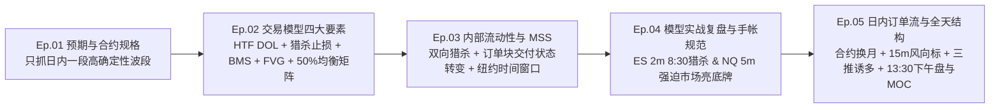
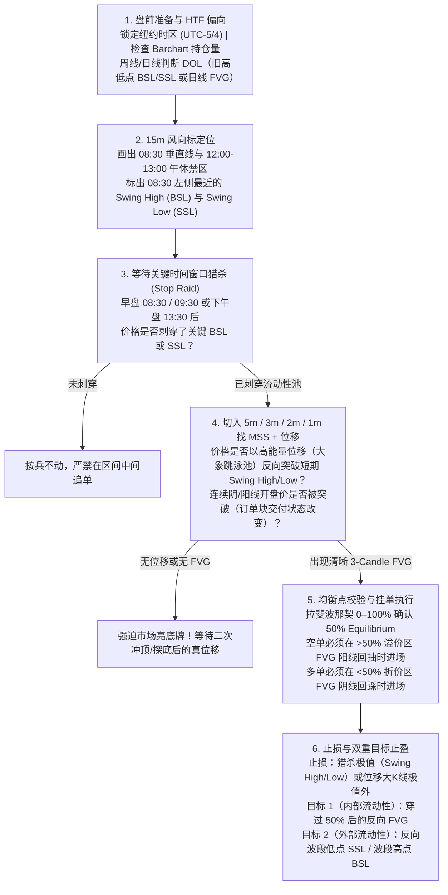

> **历史稿，待逐项复核（2026-10-25）**：已发现绝对化规则与课程归因问题。当前规则见 [条件训练框架](references/framework.md)，已核读出处见 `references/lesson-evidence.json`。本稿保留用于对照，不作为老师逐字原话或交易执行标准。

# ICT 2022 Mentorship [No Rant] 前 5 集图文精读手册（Ep. 01 – Ep. 05）

> [!NOTE]
> **版本与资料说明**：B 站视频 `BV16sH963EgW`（《【中配】【ICT 2022 no rant】- 精简无废话完整版》）对应 YouTube 频道 **SirTrader** 整理的 37 集精简版播放列表（将 ICT 原版 41 集约 45 小时课程浓缩为 5.7 小时纯干货）。全套 37 集英文逐字稿已提取并保存在本地工作区 [transcripts](file:///Users/rouen/.gemini/antigravity/scratch/ict-2022-mentorship/transcripts)，本手册聚焦 **第 1–5 集（基础模型闭环与日内订单流框架）**，配合 **22 张原片 1080p 关键帧截图** 逐图拆解。

---

## 目录与前 5 集知识演进图谱



| 集数 | 原片标题 | 时长 | 本地字幕稿 | 核心解决的问题 |
| :--- | :--- | :--- | :--- | :--- |
| **Ep. 01** | Expectations | `06:05` | [01_Expectations.md](file:///Users/rouen/.gemini/antigravity/scratch/ict-2022-mentorship/transcripts/01_Z9Ddp3uOAWg_2022%20ICT%20Mentorship%20%5BNo%20Rant%5D%20-%20Expectations.md) | 交易什么品种？点数怎么算？不要模仿高频多空反手，只抓**日内最干净的一段主波段**。 |
| **Ep. 02** | Elements To A Trade Set Up | `17:11` | [02_Elements_To_A_Trade_Set_Up.md](file:///Users/rouen/.gemini/antigravity/scratch/ict-2022-mentorship/transcripts/02_s6RN2G7-IUc_2022%20ICT%20Mentorship%20%5BNo%20Rant%5D%20ep.%202%20-%20Elements%20To%20A%20Trade%20Set%20Up.md) | **ICT 2022 核心模型首次完整公开**：周/日线偏向（DOL）$\rightarrow$ 1H/15m 诱空猎杀等高点买方止损 $\rightarrow$ 2m 跌破结构（BMS）+ 回到 FVG 做空 $\rightarrow$ 50% 溢价/折价矩阵止盈。 |
| **Ep. 03** | Internal Range Liquidity & Market Structure Shifts | `15:25` | [03_Internal_Range_Liquidity.md](file:///Users/rouen/.gemini/antigravity/scratch/ict-2022-mentorship/transcripts/03_vJWdXPe8Reo_2022%20ICT%20Mentorship%20%5BNo%20Rant%5D%20ep.%203%20-%20Internal%20Range%20Liquidity%20%26%20Market%20Structure%20Shifts.md) | 区分日内 **MSS（市场结构转变）** 与跨日 MSB；拆解同一天先扫 SSL 做多、再扫 BSL 做空的双向闭环；定义 **Order Block（订单块 = 交付状态的改变）** 与纽约时间窗口。 |
| **Ep. 04** | Examples On Episode 3 | `05:44` | [04_Examples_On_Episode_3.md](file:///Users/rouen/.gemini/antigravity/scratch/ict-2022-mentorship/transcripts/04_6UlLO86WxHs_2022%20ICT%20Mentorship%20%5BNo%20Rant%5D%20ep.%204%20-%20Examples%20On%20Episode%203.md) | 两个经典实战案例（ES 2m 8:30 猎杀、NQ 5m 等待第二波真位移与 FVG）；确立 **ICT 复盘手帐（Study Journal）** 的四项记录标准。 |
| **Ep. 05** | Intraday Order Flow And The Daily Range | `14:56` | [05_Intraday_Order_Flow.md](file:///Users/rouen/.gemini/antigravity/scratch/ict-2022-mentorship/transcripts/05_3AGDqGqZrUA_2022%20ICT%20Mentorship%20%5BNo%20Rant%5D%20ep.%205%20-%20Intraday%20Order%20Flow%20And%20The%20Daily%20Range.md) | 股指期货合约月份代码与 Barchart 持仓量换月规则；**15m 风向标图表**画法；早盘 **Three Drives（三推形态）** 诱多与“大象跳进儿童泳池”式位移；**12:00–13:00 午休禁区**与 **13:30 下午盘买方程序（Spooling）及 MOC 收盘加速**。 |

---

## Ep. 01：课程预期与股指期货底层规格（Expectations）

### 1.1 标的选择与合约跳点价值 `[00:02 – 03:00]`
ICT 2022 模型的首要设计标的是 **CME 迷你股指期货（E-mini Index Futures）**，核心聚焦于 **纳斯达克 100（NQ）** 与 **标普 500（ES）**（道指 YM 波动较缓较少参与）：

| 合约品种 | 交易代码 | 微型合约（适合小资金） | 最小跳动（1 Tick） | 1 整点（1 Handle = 4 Ticks） | 标准合约每点价值 | 微型合约每点价值 |
| :--- | :--- | :--- | :--- | :--- | :--- | :--- |
| **E-mini Nasdaq-100** | `NQ` | `MNQ` | `0.25` 点 | `1.00` 点（如 `.00` $\rightarrow$ `.25` $\rightarrow$ `.50` $\rightarrow$ `.75` $\rightarrow$ `1.00`） | **\$20.00 / 点**（\$5.00 / tick） | **\$2.00 / 点**（\$0.50 / tick） |
| **E-mini S&P 500** | `ES` | `MES` | `0.25` 点 | `1.00` 点（4 Ticks） | **\$50.00 / 点**（\$12.50 / tick） | **\$5.00 / 点**（\$1.25 / tick） |

> [!TIP]
> **报价基础设施提醒 `[03:00 – 04:01]`**：TradingView 的免费期货行情默认有延时（Delayed Data），实盘执行时必须订阅 CME 实时数据或使用经纪商平台（如 Thinkorswim / NinjaTrader）的实时报价，但复盘与画图逻辑在 TradingView 上完全一致。

### 1.2 为什么要摒弃“高频多空通吃”，专注“日内单波段” `[04:01 – 06:05]`
在 `[00:02 – 01:02]` 与 `[04:01 – 05:03]` 中，ICT 展示了自己使用 Thinkorswim 1 分钟图在同一天早盘连续做多、反手做空、再做多、再在顶部 `14,798.25` 做空并于 `14,675.75` 平仓的高频交割记录，但他明确警告学员：**不要试图模仿每一个微小波段的多空反手**，而只取右侧最干净的一段主跌浪（从 `14,798` 到 `14,675`，单笔捕获 **123 个 NQ 整点 = \$2,460 / 手**）。

````carousel
![Ep.01 [00:40]：ICT 在 Thinkorswim 上的 1m 实盘高频多空反手交割单](/Users/rouen/.gemini/antigravity/brain/2f7883a2-405d-4596-a34a-2d0b4894d4c3/ep01_tos_live_executions.png)
<!-- slide -->
![Ep.01 [04:50]：课程真正要求掌握的目标——放弃左侧高频折返，只抓右侧 14,798 空到 14,675 的单边高确定性主波段](/Users/rouen/.gemini/antigravity/brain/2f7883a2-405d-4596-a34a-2d0b4894d4c3/ep01_target_one_big_leg.png)
````

---

## Ep. 02：交易模型的四大核心要素（Elements To A Trade Set Up）

这一集是整套 **ICT 2022 模型（"The 2022 Model"）的总纲**。ICT 用前一天（2022 年 1 月 21 日周五）刚刚展示过的那笔 NQ 11:30 空单，从 **周线 $\rightarrow$ 日线 $\rightarrow$ 1 小时 $\rightarrow$ 15 分钟 $\rightarrow$ 2 分钟** 完整还原了算法是如何一步步把价格吸引到目标位的。

### 2.1 第一要素：高时间框架偏向（HTF Daily Bias）与两大流动性磁铁 `[00:03 – 04:06]`
1. **周线预期（Weekly Expansion）`[00:03 – 01:03]`**：在每周开始前，先判断下一根周线更有可能向哪个方向扩张（不需要预测周线收盘阴或阳，只需判断周内惯性是向上还是向下推进）。
2. **日线两大流动性磁铁（Draw on Liquidity, DOL）`[01:03 – 04:06]`**：价格不会随机游走，它像回形针被磁铁吸引一样，在日线图上永远只寻找两样东西：
   - **① 止损池（Stops / Liquidity）**：旧高点上方的 **买方止损（Buyside Liquidity, BSL）** 与旧低点下方的 **卖方止损（Sellside Liquidity, SSL）**。
   - **② 失衡区 / 公允价值缺口（Imbalance / Fair Value Gap, FVG）**：单根大 K 线快速穿过某价位区域，导致前一根 K 线的极值与后一根 K 线的极值之间没有重叠。
   - 在本例中，NQ 日线前期的看跌失衡已被回补，下方 `14,366.75`（2021 年 10 月旧低点）下方堆积着厚重的 **卖方止损（SSL）**。当周四冲高大幅回落收大阴线后，周五的日内偏向非常明确：**逢高寻找做空机会，目标是送价格去扫日线 `14,366.75` 下方的卖方流动性**。

### 2.2 第二要素：日内诱导（Inducement）与猎杀相对等高点 `[04:06 – 07:06]`
既然大方向看空，为什么不能在周五早上直接追空？
- **1 小时 / 15 分钟结构制造“诱空陷阱”（Sucker Play）`[04:06 – 06:06]`**：周五早盘前，价格先跌破了一个短期震荡低点（`~14,600` 下方的 `Sellside Liquidity [Sell Stops]`）。这会触发突破派散户追空，同时扫掉早盘多头的止损。
- **攻击相对等高点（Relative Equal Highs）上方的买方止损 `[06:06 – 07:06]`**：散户教科书认为“双顶/等高点是强阻力”，大量空头把止损（Buy Stops）放在 `14,820` 等高点正上方，突破派多头也在此挂突破买单（Buy Stops）。**聪明钱（Smart Money）需要大量高价买单作为对手盘才能建仓大额空单**，因此算法在扫完下方小低点后，掉头向上拉升，一举刺穿 `14,820` 上方的 `Buyside Liquidity [Buy Stops]`！

### 2.3 第三要素：低时间框架（2m/1m/3m）结构跌破（BMS）与 FVG 进场 `[08:07 – 12:09]`
当价格刺穿 15 分钟级别的买方流动性池（`14,820`）后，**严禁在冲高过程中盲目摸顶**，而是立刻切入 **5 分钟 $\rightarrow$ 3 分钟 $\rightarrow$ 2 分钟 $\rightarrow$ 1 分钟图表**（因为高频交易算法 HFT 核心运行在 1m–3m 及 15s–60s 级别）：
1. **等待市场结构跌破（Break in Market Structure, BMS / MSS）`[09:07 – 11:08]`**：观察推动价格创出最高点的那波上涨中，最近的一个**短期波段低点（Swing Low，约 `14,808`）**。只有当价格有力向下跌破该波段低点时，才确认算法已完成高点猎杀并转向空头交付。
2. **在位移腿内部寻找公允价值缺口（Fair Value Gap, FVG）`[11:08 – 12:09]`**：检查跌破该短期低点的这波下跌位移（Displacement）中是否存在 **三根 K 线不重叠的看跌 FVG**：
   - **第 1 根 K 线的最低价（Candle 1 Low）** 与 **第 3 根 K 线的最高价（Candle 3 High）** 之间留出空白（图中橙色高亮框）。
   - **进场与止损规则**：当第 3 根 K 线收盘、第 4 根阳线向上回抽触及 FVG 下沿时直接挂空单进场（遵守“**做空必须在阳线回抽时卖出**”的原则），止损放在 **波段最高点（Swing High）上方** 或 **位移大阴线最高点上方**。

### 2.4 第四要素：50% 斐波那契均衡点（Equilibrium）与溢价/折价止盈矩阵 `[12:09 – 16:13]`
怎么判断这个空单 FVG 的位置够不够好？止盈目标设在哪里？
1. **划分交易区间（Dealing Range）**：用斐波那契工具从当天上午启动上涨的 **最低点（`~14,535`）** 拉到猎杀后的 **最高点（`~14,855`）**，只保留 `0`、`0.5（50%）`、`1` 三条线。
2. **溢价区（Premium）与折价区（Discount）**：
   - **高于 50% 中轴（红色阴影区）= 溢价区（Premium Market）**：价格偏贵，只允许在溢价区的看跌 FVG 做空。
   - **低于 50% 中轴（绿色阴影区）= 折价区（Discount Market）**：价格便宜，空单必须回到 50% 以下的折价区平仓止盈，多单只允许在折价区建仓。
3. **内外流动性双重止盈目标（Internal & External Range Liquidity）`[13:10 – 16:13]`**：
   - **第一目标（内部流动性 Internal Range Liquidity）**：折价区内前期快速拉升留下的 **看涨 FVG（Imbalance）**（图中两条蓝色水平目标线：`~14,680` 与 `~14,650`）。
   - **第二/终极目标（外部流动性 External Range Liquidity）**：折价区各个波段低点下方的 **卖方止损（Sell Stops）**，直至整个区间最低点乃至日线 `14,366.75` 目标。

````carousel
![Ep.02 [00:45] 步骤 1（周线 1W）：判断下一根周线向下的扩张惯性（Weekly Bias）](/Users/rouen/.gemini/antigravity/brain/2f7883a2-405d-4596-a34a-2d0b4894d4c3/ep02_weekly_bias_candle.png)
<!-- slide -->
![Ep.02 [01:55] 步骤 2（日线 1D）：识别下方 14,366.75 旧低点下方的卖方止损池（SSL）作为磁铁（DOL）](/Users/rouen/.gemini/antigravity/brain/2f7883a2-405d-4596-a34a-2d0b4894d4c3/ep02_daily_ssl_and_imbalance.png)
<!-- slide -->
![Ep.02 [04:55] 步骤 3（1小时 1H）：周五早盘先跌破短期低点诱空（Sucker Play），随后掉头拉升去扫上方相对等高点](/Users/rouen/.gemini/antigravity/brain/2f7883a2-405d-4596-a34a-2d0b4894d4c3/ep02_hourly_induce_shorts_run_bsl.png)
<!-- slide -->
![Ep.02 [07:20] 步骤 4（15分钟 15m）：清晰标注先扫 Sellside Liquidity [Sell Stops]（14,602），再冲高猎杀 Buyside Liquidity [Buy Stops]（14,820）](/Users/rouen/.gemini/antigravity/brain/2f7883a2-405d-4596-a34a-2d0b4894d4c3/ep02_15m_equal_highs_stop_hunt.png)
<!-- slide -->
![Ep.02 [11:35] 步骤 5（2分钟 2m）：冲高扫完 BSL 后跌破短期波段低点（BMS），并在位移腿内留下橙色看跌 FVG 供回抽做空](/Users/rouen/.gemini/antigravity/brain/2f7883a2-405d-4596-a34a-2d0b4894d4c3/ep02_2m_bms_and_fvg_entry.png)
<!-- slide -->
![Ep.02 [13:15] 步骤 6（2分钟 2m 均衡矩阵）：从波段低点拉到高点，50% 以上为红色溢价区（做空区），50% 以下为绿色折价区（止盈区）](/Users/rouen/.gemini/antigravity/brain/2f7883a2-405d-4596-a34a-2d0b4894d4c3/ep02_2m_fib_equilibrium_matrix.png)
<!-- slide -->
![Ep.02 [15:05] 步骤 7（2分钟 2m 止盈目标）：空单在溢价区橙色 FVG 进场，第一、二止盈位精准设在折价区内部看涨失衡（蓝线 14,680 & 14,650）](/Users/rouen/.gemini/antigravity/brain/2f7883a2-405d-4596-a34a-2d0b4894d4c3/ep02_2m_full_setup_annotated.png)
````

---

## Ep. 03：内部区间流动性与市场结构转变（Internal Range Liquidity & Market Structure Shifts）

在第 3 集中，ICT 进一步回答了两个核心问题：
1. **即便大级别看跌，早盘先扫完下方 `14,600` 卖方流动性后、去扫上方 `14,820` 买方流动性之前的那段 220 点日内多头波段，能不能用完全相同的规则做多？**（答案是：**完全对称，多空同源！**）
2. **什么是真正的订单块（Order Block）与“交付状态的改变（Change in the State of Delivery）”？**

### 3.1 MSS（市场结构转变）与 MSB（市场结构破坏）的区别 `[01:05 – 02:05]`
- **Market Structure Break (MSB)**：高时间框架（日线/周线级别）决定数天乃至数周趋势反转的重大结构突破。
- **Market Structure Shift (MSS)**：**日内级别（1m / 2m / 5m）** 的短期结构转变。哪怕当天晚些时候价格还会再次回到该高点或低点，只要发生了猎杀止损后的 **日内 MSS + FVG**，就足以支撑一段几十到上百点的日内波段（Intraday Price Leg）。

### 3.2 2 分钟 / 1 分钟多空双向对称执行拆解 `[02:05 – 08:07]`
在同一张 2022 年 1 月 21 日 NQ 图表上，早盘 `08:30` 之后先后出现了两次教科书式机会：

1. **上午 10:20 猎杀卖方止损后的多头模型（Bullish MSS + FVG + OB）`[03:06 – 06:06]`**：
   - **Stop Raid（扫止损）**：价格跌破 `14,600` 下方的 `Sellside Liquidity`，一直探至 `~14,538` 扫空早盘多头止损。
   - **Bullish Market Structure Shift（看涨市场结构转变）**：扫完低点前的最后一个短期波段高点（Swing High）在 `~14,634`（橙色向上小三角虚线）。价格强力拉升刺穿 `14,634`！
   - **重要细节 `[05:06 – 06:06]`**：刺穿 `14,634` 的那根 K 线**甚至不需要收盘在 `14,634` 上方**，只要盘中最高价突破了该波段高点，并且在三根 K 线序列中留下了 **看涨 FVG（橙色灯泡标注处）**，当下一根阴线回踩进入该看涨 FVG 时即可挂多单进场，目标直指上方 `14,820` 的 `Buyside Liquidity`！
2. **上午 11:25 猎杀买方止损后的空头模型（Bearish MSS + FVG）`[06:06 – 08:07]`**：
   - 价格冲过 `14,820` 完成上方 `Stop Raid`，随后跌破短期波段低点（`Bearish Market Structure Shift`），留下看跌 FVG（上方橙色灯泡标注处），回抽进场做空，目标看回折价区（50% 以下）的内部看涨 FVG 与下方低点。

### 3.3 核心机制解密：订单块（Order Block）= 交付状态的改变（Change in State of Delivery） `[08:07 – 11:08]`

> [!IMPORTANT]
> **ICT 对算法定价与订单块的底层定义 `[08:07 – 10:07]`**：
> 市场价格不是被散户买卖量“推”动的，而是由定价算法（IPDA）按固定时间步长连续向上或向下报价（称为 **Spooling，像线轴放线一样连续递增/递减报价**）。
> - **看涨订单块（Bullish Order Block）**：当价格向下刺穿 `14,600` 卖方流动性时，**那一连串连续收阴的 K 线（Consecutive Down-Closed Candles）合在一起构成一个整体的看涨订单块**。当价格随后向上突破这串连续阴线**第一根 K 线的开盘价（Opening Price）**时，算法的**交付状态（State of Delivery）正式从卖方交付切换为买方交付**！此后价格回踩到该订单块开盘价与上方 FVG 重合处，就是极高胜率的机构多头进场位。
> - **看跌订单块（Bearish Order Block）**：当价格向上刺穿 `14,820` 买方流动性时，**那一连串连续收阳的 K 线（Consecutive Up-Closed Candles）合在一起构成看跌订单块**。当价格向下跌破这串连续阳线**第一根 K 线的开盘价**时，**交付状态正式切换为卖方交付**！

````carousel
![Ep.03 [02:35] 15分钟全景：早盘 08:30 垂直线右侧，下方 14,600 为 Sellside Liquidity，上方 14,820 为 Buyside Liquidity](/Users/rouen/.gemini/antigravity/brain/2f7883a2-405d-4596-a34a-2d0b4894d4c3/ep03_15m_ssl_and_bsl_pools.png)
<!-- slide -->
![Ep.03 [05:10] 2分钟多头闭环：10:20 扫完下方 Stop Raid 后突破短期高点（Bullish MSS），回踩看涨 FVG（橙色灯泡）做多直奔 14,820](/Users/rouen/.gemini/antigravity/brain/2f7883a2-405d-4596-a34a-2d0b4894d4c3/ep03_2m_bullish_mss_fvg_ob.png)
<!-- slide -->
![Ep.03 [06:45] 2分钟空头闭环：11:25 扫完上方 14,820 Stop Raid 后跌破短期低点（Bearish MSS），回抽看跌 FVG（橙色灯泡）做空](/Users/rouen/.gemini/antigravity/brain/2f7883a2-405d-4596-a34a-2d0b4894d4c3/ep03_2m_bearish_mss_fvg_targets.png)
<!-- slide -->
![Ep.03 [09:30] 1分钟拆解：连续拉升刺穿高点的一串阳线构成看跌订单块（OB），跌破其开盘价即发生“交付状态的改变（Change in State of Delivery）”](/Users/rouen/.gemini/antigravity/brain/2f7883a2-405d-4596-a34a-2d0b4894d4c3/ep03_1m_orderblock_state_of_delivery.png)
<!-- slide -->
![Ep.03 [11:45] 1分钟完整标注图（ICT 称为 "Lipstick on the Chart"）：1m 级别比 2m 更早、更紧凑地触发 Bullish MSS 与 Bearish MSS](/Users/rouen/.gemini/antigravity/brain/2f7883a2-405d-4596-a34a-2d0b4894d4c3/ep03_1m_full_lipstick_chart.png)
````

### 3.4 纽约时间（NY Local Time）关键盘口流动性参考点 `[12:08 – 15:25]`
在打开任何日内图表前，**必须先把 TradingView 右下角时区锁定为 `New York (UTC-5 / 夏令时 UTC-4)`**，并重点标注前一日及当日三大时段的最高价与最低价（它们是日内算法最常猎杀的止损池）：

| 关键时段 / 节点 | 纽约本地时间（NY Time） | 核心作用与交易纪律 |
| :--- | :--- | :--- |
| **亚洲盘区间（Asia Range）** | `19:00 – 21:00`（或延展至 `00:00` 午夜） | 标注亚盘高点（Asia High）与亚盘低点（Asia Low）作为潜在外部流动性池。 |
| **伦敦盘区间（London Killzone）** | `02:00 – 05:00` | 伦敦盘往往确立当天第一个重要高点或低点，其极值上方/下方聚集大量止损。 |
| **纽约外汇窗口（NY Forex）** | `07:00 – 10:00` | 包含 `08:30` 重磅宏观数据发布窗口。 |
| **股指早盘黄金窗口（AM Session）** | **`08:30 – 12:00`**（最佳收工时间 `11:00` 前） | `08:30` 新闻数据开锣（"Starts the hunt"），`09:30` 美股现货开盘（Equities Open）常伴随剧烈诱多/诱空猎杀。 |
| **纽约午休禁区（NY Lunch）** | **`12:00 – 13:00`** | **绝对禁止开新仓！** 算法的趋势交付在此暂停，极易来回扫止损或横盘磨损。 |
| **股指下午盘窗口（PM Session）** | **`13:30 – 16:00`**（核心机会在 `14:00 – 15:00`） | `13:30` 算法宏启动，常先扫午休高/低点再走下午单边，并在 `15:40–16:00` 因 MOC 收盘指令加速。 |

---

## Ep. 04：实战案例拆解与复盘手帐规范（Examples On Episode 3）

第 4 集通过连续两天（2022 年 1 月 26 日 ES 与 1 月 27 日 NQ）的实战盘面，重点训练一项核心能力：**当价格扫完上方买方止损后，如果第一波回落没有出现 FVG 或没有跌破结构，如何忍住不动手，强迫市场先亮出底牌（"Forcing the market to tip its hand"）！**

### 4.1 案例一：ES 2 分钟早盘 8:30 猎杀与复盘手帐四要素 `[00:02 – 03:35]`
- **背景（2022 年 1 月 26 日周三，ES 2m 图）**：从凌晨 `02:15` 低点拉升至 `08:30` 前高点 `4,423.25`，计算出 50% 均衡点位于 `4,392.00`（图中左侧红线）。
- **猎杀与真假 MSS 甄别 `[01:02 – 02:03]`**：
  1. `08:30` 垂直线之后，价格在 `09:30` 美股现货开盘后向上拉升，冲破 `4,423.25` 的 `Buyside Liquidity`。
  2. **第一次回落（假信号过滤）**：价格首次冲高后曾跌破一个小波段低点，但**仔细检查那几根下跌 K 线，内部没有任何 Fair Value Gap（每根 K 线都有重叠）** $\rightarrow$ **无 FVG 不进场！**
  3. **第二次冲高与真位移 + FVG**：价格再往上拱出新高（`~4,436`），随后强力下砸跌破短期波段低点（橙色向下小三角虚线，`~4,418`），且在这根大阴线位移中留下了清晰的 **看跌 FVG（橙色灯泡标注）**。
  4. **进场与止盈**：回抽 FVG 在 `~4,419` 做空，一路持有到 50% 均衡线（`4,392`）以下的折价区看涨 FVG 与旧低点 `4,381.75` 平仓，单笔斩获 **37 个 ES 整点（\$1,850 / 手）**。

> [!TIP]
> **ICT 标准化复盘手帐（Study Journal）必记的 4 项数据 `[02:03 – 03:35]`**：
> 每次截取这样一张带标注的复盘图存档时，必须在图上写明：
> 1. **MSS 到回抽进场的耗时**：从跌破波段低点（MSS）到价格回抽填补 FVG 触发进场，经历了多少分钟？
> 2. **进场到止盈目标的耗时**：从挂单成交到触及折价区目标位，持仓了多少分钟？
> 3. **最大浮亏 / 抗单回撤（Heat Weathered）**：进场后价格向止损方向最多逆行了几个点（Handles/Ticks）？
> 4. **潜在总利润空间**：从 FVG 进场位到目标位一共走了多少个整点？

### 4.2 案例二：NQ 5 分钟“强迫市场亮出底牌” `[03:35 – 05:44]`
- **背景（2022 年 1 月 27 日周四，NQ 5m 图）**：`08:30` 前存在清晰的相对等高点与旧高点 `Buyside Liquidity`（`~14,282`），50% 均衡点在 `14,127.00`。
- **第一波回落为什么坚决不做空？`[04:36 – 05:44]`**：
  - 价格突破 `14,282` 后曾出现第一波小幅回调，但**既没有跌破前一个短期波段低点，下杀过程中也完全没有 FVG**。如果在这里凭感觉摸顶做空，立刻会被随后的二次冲高（拉到 `14,405`）打掉止损！
  - **正确做法**：耐心等到价格冲至 `14,405` 后，一根长阴线放量下砸跌破短期波段低点（橙色三角箭头），并在 `14,335 – 14,345` 留下清晰的 `FVG`。随后连续多根 5m K 线回抽该 FVG 均完美受阻，空单顺势瀑布式下泄，击穿 `14,127` 均衡线后直达下方 `14,044.25` 与 `14,018.75` 两个折价区内部流动性目标（眼睛图标标注处）！

````carousel
![Ep.04 [00:45] 案例一（ES 2m 全景）：50% 均衡线（4,392）上方扫掉 Buyside Liquidity，空头一路交付至折价区 4,381.75 旧低点](/Users/rouen/.gemini/antigravity/brain/2f7883a2-405d-4596-a34a-2d0b4894d4c3/ep04_es_2m_equilibrium_overview.png)
<!-- slide -->
![Ep.04 [02:15] 案例一（ES 2m 局部放大）：第一次冲高回落无 FVG 过滤不进；第二次冲高跌破波段低点（橙色三角）并留下看跌 FVG（橙色灯泡）精准进场](/Users/rouen/.gemini/antigravity/brain/2f7883a2-405d-4596-a34a-2d0b4894d4c3/ep04_es_2m_830_zoomed_journal.png)
<!-- slide -->
![Ep.04 [04:50] 案例二（NQ 5m）：第一波过顶回落既无 MSS 也无 FVG，按兵不动；等待二次冲高后真跌破 + FVG 回抽做空，直达 50% 以下眼睛图标目标位](/Users/rouen/.gemini/antigravity/brain/2f7883a2-405d-4596-a34a-2d0b4894d4c3/ep04_nq_5m_wait_for_fvg_entry.png)
````

---

## Ep. 05：日内订单流与全天区间结构（Intraday Order Flow And The Daily Range）

第 5 集补齐了实盘交易者每天从开盘前准备到下午 `16:00` 收盘的**全天候日内订单流剧本（Daily Range & Intraday Order Flow）**。

### 5.1 股指期货合约代码、交割月份与持仓量换月法则 `[00:01 – 02:45]`
1. **四大季度交割月份代码（Delivery Month Codes）**：
   - **`H` = 3 月（March）**（如 `ESH2022` / `ESH22`）
   - **`M` = 6 月（June）**（如 `ESM2022`）
   - **`U` = 9 月（September）**（如 `ESU2022`）
   - **`Z` = 12 月（December）**（如 `ESZ2022`）
2. **到期日与换月（Rollover）铁律 `[01:02 – 02:45]`**：
   - 合约在每个交割月份的 **第三个星期五（3rd Friday）** 到期。
   - 在到期前约一周（即第三个周五之前的周一/周二），打开 `barchart.com` 搜索当前合约（如 `ESH22`），查看列表中各月份合约的 **Open Int（未平仓合约量 / 持仓量）**。
   - **换月触发条件**：一旦下一个季度合约（如 `ESM22`）的 `Open Int` 超过当前近月合约（`ESH22`），立即停止交易近月合约，切换至下一季度主力合约（图中 2 月初 `ESH22` 持仓量为 `2,264,209`，远大于 `ESM22` 的 `57,310`，因此当时交易 `ESH22`）。

![Ep.05 [01:55]：在 Barchart.com 查看 ESH22、ESM22、ESU22、ESZ22 的未平仓量（Open Int）决定主力合约换月时机](/Users/rouen/.gemini/antigravity/brain/2f7883a2-405d-4596-a34a-2d0b4894d4c3/ep05_barchart_open_interest_rollover.png)

### 5.2 15 分钟“风向标图表（Bellwether Chart）”与全天三段式切割 `[02:45 – 05:05]`
ICT 把 **15 分钟图** 称为日内交易的“风向标（Bellwether）”：
1. **三条垂直时间分割线**：
   - **`08:30 AM`**：早盘宏观数据与猎杀启动线。
   - **`12:00 PM – 13:00 PM`（红色竖条阴影区）**：纽约午休禁区（New York Lunch）。
   - **`16:00 PM`**：美股与股指日内主力时段收盘参考线。
2. **标注 `08:30` 左侧的关键波段高点（Swing High）与波段低点（Swing Low）**：
   - **Swing High 定义**：中间一根 K 线最高价高于左右紧邻两根 K 线最高价的三 K 线组合。
   - **Swing Low 定义**：中间一根 K 线最低价低于左右紧邻两根 K 线最低价的三 K 线组合。
   - 在 `08:30` 垂直线左侧紧邻处标出最近的 15m 波段高点（`~4,514.50`）与波段低点（`~4,482.00`）——这就是早盘 `08:30–09:30` 算法首要攻击的流动性靶标！

### 5.3 早盘剧本：三推诱多（Three Drives Pattern）与“大象跳进儿童泳池”式位移 `[05:05 – 08:07]`
切入 5 分钟图观察 `08:30` 后的早盘走势（2022 年 2 月 1 日 ES 5m）：
1. **三推形态（Three Drives Pattern）与诱多蓄势 `[05:05 – 06:06]`**：价格向 `03:00` 伦敦盘高点 `4,514.50` 推进时，连续走出 **三个依次抬高的阶段性高点（1 $\rightarrow$ 2 $\rightarrow$ 3 Drives）**。每一次冲高回落都在吸引跟风多头进场并把止损垫在下方，同时第 3 推精准刺穿 `4,514.50` 旧高点买方流动性。
2. **什么是真正的位移（Energetic Displacement）？`[06:06 – 08:07]`**：
   - ICT 用了一个极其生动的比喻：**真正的位移不是软绵绵的阴跌（Anemic），而是“像一头大象跳进儿童充气泳池里一样，水花四溅！”（An elephant jumping in a children's swimming pool）**。
   - 在 `09:30` 美股开盘完成第 3 推猎杀后，一根巨大的 5 分钟长阴线瞬间砸穿短期支撑并留下清晰的 **看跌 FVG**。下一根 K 线向上回抽该 FVG 即可进场做空，短短 15 分钟内价格直接瀑布式击穿早盘低点 `4,482.00`！

### 5.4 下午盘剧本：`13:30` 算法宏启动、买方程序 Spooling 与收盘 MOC 加速 `[08:07 – 14:56]`
当早盘走完双向扫荡（扫完 `4,514.50` 高点又扫完 `4,482.00` 低点）并在 `11:00–12:00` 在高点附近留下一排干净的相对等高点（Clean Highs）后，下午盘如何演绎？
1. **`12:00 – 13:00` 午休禁区**：价格回撤整理，无论看起来多像机会都绝不交易。
2. **`13:30 PM` 猎杀下午盘第一个短期低点启动买方程序（Buy Program）`[09:07 – 13:09]`**：
   - 下午 `13:30` 之后，等待市场先形成第一个短期波段低点（`~14:00` 附近的 `4,504`）。
   - 在 `14:10–14:20`，算法向下軽く一刺，扫掉这个 `13:30` 后的短期波段低点（完成下午盘诱空猎杀），随即立即拉起！
   - **两种下午盘多头进场方式**：
     - **激进预判型**：在 `13:30` 后的短期小低点被刺穿并立刻收回时进场（博弈上方早盘 `4,515` 相对等高点必被攻破）。
     - **稳健确认型**：如果不出现扫低点或错过了底部，等待价格向上突破 `13:30` 后高点产生强力位移（`14:55` 大阳线），在随后的 **5m 看涨 FVG** 回踩时挂单做多。
3. **Spooling（算法线性逼空）与 `15:40 – 16:00` MOC 收盘加速 `[13:09 – 14:56]`**：
   - 一旦突破早盘等高点 `4,515`，算法开启 **Buy Program Spooling**——几乎每一根 5m K 线都连续收阳、极少深调。
   - 当下午处于单边多头趋势时，重点盯紧 **`15:40`、`15:50` 到 `16:00`** 这最后 20 分钟：**Market-on-Close（MOC，收盘市价指令）** 会引发最后一波加速冲顶，是在 `16:00` 收盘前平仓落袋的最佳时机！

````carousel
![Ep.05 [04:15] 15分钟风向标（Bellwether Chart）：标出 08:30 左侧波段高低点、12:00-13:00 粉色午休禁区与下午单边趋势](/Users/rouen/.gemini/antigravity/brain/2f7883a2-405d-4596-a34a-2d0b4894d4c3/ep05_15m_daily_range_830_lunch.png)
<!-- slide -->
![Ep.05 [06:10] 5分钟早盘结构：08:30 后走出三推诱多（Three Drives）刺穿 4,514.50 旧高点，随后“大象跳泳池”式长阴位移砸穿 4,482 低点](/Users/rouen/.gemini/antigravity/brain/2f7883a2-405d-4596-a34a-2d0b4894d4c3/ep05_5m_three_drives_displacement_fvg.png)
<!-- slide -->
![Ep.05 [07:50] 5分钟早盘 FVG 放大：第 3 推扫高点后长阴线留下的看跌 FVG，下一根 K 线回抽即空，15 分钟直达下方 4,482 卖方流动性池](/Users/rouen/.gemini/antigravity/brain/2f7883a2-405d-4596-a34a-2d0b4894d4c3/ep05_5m_fvg_zoomed_in.png)
<!-- slide -->
![Ep.05 [10:40] 5分钟下午盘启动：12:00-13:00 午休结束后，14:15 向下刺穿 13:30 后的第一个短期低点（紫色高亮手势处），洗盘后正式启动下午买方程序](/Users/rouen/.gemini/antigravity/brain/2f7883a2-405d-4596-a34a-2d0b4894d4c3/ep05_5m_pm_session_130_stop_hunt.png)
<!-- slide -->
![Ep.05 [14:35] 5分钟下午盘 Spooling 与 MOC 收盘冲刺：14:55 大阳线突破早盘等高点并留下 FVG，算法一路逼空拉升至 15:40–16:00 收盘高潮](/Users/rouen/.gemini/antigravity/brain/2f7883a2-405d-4596-a34a-2d0b4894d4c3/ep05_5m_pm_spooling_moc.png)
````

---

## 附：ICT 2022 模型（前 5 集）实盘执行与复盘核对清单（Checklist）



### 盘前与盘中 6 步核对表
- [ ] **1. 时区与合约检查**：TradingView 右下角已设为 `New York` 时间；若临近 3/6/9/12 月第三个周五前一周，已在 `barchart.com` 核对 `Open Int` 完成主力换月。
- [ ] **2. 日线 DOL 磁铁确认**：今天日线价格是被吸向上方的 **买方止损（BSL）/ 看跌 FVG**，还是下方的 **卖方止损（SSL）/ 看涨 FVG**？
- [ ] **3. 15m 关键流动性画线**：已标出亚盘（`19:00–21:00`）、伦敦盘（`02:00–05:00`）以及 **`08:30 AM` 左侧最近的 15m 波段高点与波段低点**（特别留意散户视为强阻力的 **相对等高点 Relative Equal Highs**）。
- [ ] **4. 猎杀 + MSS + FVG 三重验证**：
  - [ ] 价格在 `08:30` / `09:30`（或下午 `13:30` 后）已完成对上述流动性池的刺穿猎杀（Stop Raid）。
  - [ ] 在 `5m / 2m / 1m` 图表上，价格以**剧烈位移（Displacement）**突破了短周期波段高/低点（MSS），且突破了连续阳/阴线订单块的起始开盘价（State of Delivery 改变）。
  - [ ] 位移腿内部存在**干净无重叠的三 K 线公允价值缺口（FVG）**（若第一波回落无 FVG，坚决放弃并等待二次测试后的真位移）。
- [ ] **5. 50% 均衡点（Equilibrium）过滤**：拉取当前交易区间斐波那契 `50%`，确认做空进场点位于 **50% 以上的溢价区（Premium）**，做多进场点位于 **50% 以下的折价区（Discount）**。
- [ ] **6. 止盈与时间纪律**：
  - [ ] 止盈分批挂在 **50% 另一侧的内部反向 FVG** 与 **外部旧高/低点止损池**。
  - [ ] 严守 **`12:00 – 13:00` 纽约午休空仓铁律**；下午盘持仓留意 `15:40 – 16:00` MOC 收盘加速平仓。
