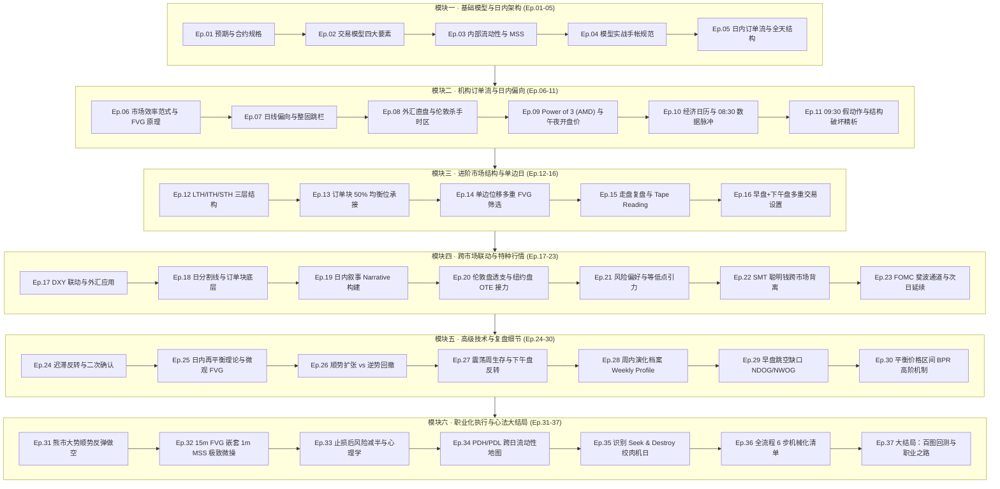
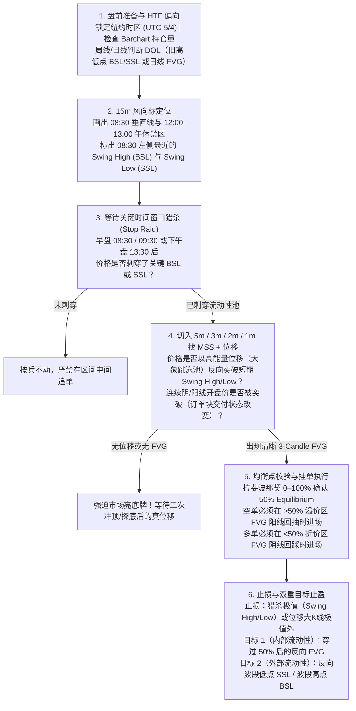

> **历史稿，待逐项复核（2026-10-25）**：已发现绝对化规则与课程归因问题。当前规则见 [条件训练框架](references/framework.md)，已核读出处见 `references/lesson-evidence.json`。本稿保留用于对照，不作为老师逐字原话或交易执行标准。

# ICT 2022 Mentorship [No Rant] 全 37 讲图文精读手册（Ep. 01 – Ep. 37）

> [!NOTE]
> **版本与资料说明**：B 站视频 `BV16sH963EgW`（《【中配】【ICT 2022 no rant】- 精简无废话完整版》）对应 YouTube 频道 **SirTrader** 整理的 37 集精简版播放列表（将 ICT 原版 41 集约 45 小时课程浓缩为 5.7 小时纯干货）。全套 37 集英文逐字稿已提取并保存在本地工作区 [transcripts](file:///Users/rouen/.gemini/antigravity/scratch/ict-2022-mentorship/transcripts)，本手册覆盖 **全 37 集（全六大模块）完整图文深度精读**，配合 **63 张原片 1080p 关键帧高清图解与架构图谱** 逐图拆解。

---

## 目录与全 37 讲六大演进模块知识图谱



### 全 37 讲目录清单与核心解决问题速查表

| 集数 | 原片英文标题 | 模块归属 | 高清图解 | 核心解决问题与机构技术要点 |
| :--- | :--- | :--- | :--- | :--- |
| **Ep. 01** | Expectations | Module 1 · 核心模型与日内基石 (Ep 01–05) | `2 张` | 确立本课程唯一目标：摒弃高频多空来回反手，专注在 E-mini 股指期货（NQ / ES）日内捕捉一段高确定性的单边价格腿（Intraday Price Leg）。明确 NQ（$20/点）与 ES（$50/点）及微型合约 MNQ/MES 的跳点换算与实时行情要求。 |
| **Ep. 02** | ep. 2 - Elements To A Trade Set Up | Module 1 · 核心模型与日内基石 (Ep 01–05) | `7 张` | 首次完整拆解 ICT 2022 核心交易模型：1) 周/日线判断流动性吸引方向（DOL：旧高低点止损池或失衡区）；2) 1H/15m 观察诱空后向上猎杀相对等高点买方止损（BSL）；3) 切入 2m/1m 等待跌破短期波段低点（BMS）并在位移腿内找看跌 FVG 阳线回抽做空；4) 用 50% 斐波那契均衡点划分溢价/折价区，在折价区内部 FVG 与外部 SSL 分批止盈。 |
| **Ep. 03** | ep. 3 - Internal Range Liquidity & Market Structure Shifts | Module 1 · 核心模型与日内基石 (Ep 01–05) | `5 张` | 界定日内市场结构转变（MSS）与跨日 MSB 的区别；在同一张 NQ 图表上完整演示先扫 14,600 SSL 做多至 14,820、再扫 14,820 BSL 反手做空的双向闭环；首次从算法 Spooling 角度定义 Order Block（连续阴/阳线开盘价被突破 = 交付状态的改变），并给出纽约时间三大流动性时段与作息铁律。 |
| **Ep. 04** | ep. 4 - Examples On Episode 3 | Module 1 · 核心模型与日内基石 (Ep 01–05) | `3 张` | 通过 1 月 26 日 ES 2m 与 1 月 27 日 NQ 5m 两个连续交易日案例，演示当价格扫掉 BSL 后如果第一波回落没有产生 FVG 或未跌破波段低点时，如何耐心过滤假动作、“强迫市场先亮出底牌”，并确立复盘手帐必记的四项量化指标。 |
| **Ep. 05** | ep. 5 - Intraday Order Flow And The Daily Range | Module 1 · 核心模型与日内基石 (Ep 01–05) | `6 张` | 详解期货季度交割月份代码（H/M/U/Z）与 Barchart 未平仓量换月法则；建立 15m 风向标图表（标注 08:30 左侧高低点与 12:00–13:00 午休禁区）；拆解早盘三推诱多（Three Drives）后的高能量位移（“大象跳进儿童泳池”）与下午盘 13:30 扫低点启动买方 Spooling 直至 15:40–16:00 MOC 收盘加速的全天剧本。 |
| **Ep. 06** | ep. 6 - Market Efficiency Paradigm & Institutional Order Flow | Module 2 · 日线偏向与 AMD 权力三段 (Ep 06–12) | `2 张` | 深入剖析散户视角与机构算法视角（Market Efficiency Paradigm）的根本对立：散户把等高/等低点当支撑阻力，而大资金必须利用这些位置的止损单作为建仓与平仓的流动性池。结合真实交割单演示早盘窄幅震荡诱空、美股开盘后冲高回落再拉升的机构订单流跟踪。 |
| **Ep. 07** | ep. 7 - Daily Bias & Consolidation Hurdles | Module 2 · 日线偏向与 AMD 权力三段 (Ep 06–12) | `2 张` | 专门解决学员最头疼的“日线偏向（Daily Bias）判断失误”问题：当市场经历大幅单边扩张后，往往进入数日的区间整固（Consolidation Hurdles）。讲解如何在日线大区间内部利用“外部流动性扫荡 → 内部 50% FVG 回补 → 外部流动性目标”的循环来确立每一天的偏方向。 |
| **Ep. 08** | ep. 8 - Applying Institutional Order Flow To Forex Markets | Module 2 · 日线偏向与 AMD 权力三段 (Ep 06–12) | `2 张` | 证明 ICT 2022 模型并非只适用于美股指期货，在外汇直盘（EURUSD / GBPUSD）上同样精准有效。演示如何结合美元指数（DXY）偏向，在伦敦盘（02:00–05:00）与纽约外汇盘（07:00–10:00）运用完全相同的 Stop Raid + MSS + FVG 框架。 |
| **Ep. 09** | BmZ-8I_ep. 9 - Power of 3 & New York PM Session Opportunities | Module 2 · 日线偏向与 AMD 权力三段 (Ep 06–12) | `2 张` | 引入 ICT 经典核心概念 Power of 3（Accumulation 积累 → Manipulation 操纵/诱多诱空 → Distribution 派发/真趋势）：以纽约午夜开盘价（00:00 NY Midnight Open）与 08:30 开盘价为基准，看懂为什么看跌日必须先在开盘价上方制造上影线（Judas Swing），看涨日必须先在开盘价下方制造下影线。 |
| **Ep. 10** | ep. 10 - Implementing Economic Calendar Events With The Open | Module 2 · 日线偏向与 AMD 权力三段 (Ep 06–12) | `2 张` | 教你如何把宏观经济日历（ForexFactory 高危数据时间）与 Power of 3 结合：经济数据本身不是方向的原因，而是算法用来快速扫掉流动性池、完成 Manipulation（操纵段）的时间触发器。 |
| **Ep. 11** | ep. 11 - Reinforcing Past Lessons & Trading Executions | Module 2 · 日线偏向与 AMD 权力三段 (Ep 06–12) | `2 张` | 通过高密度图表案例，深入剖析美股 09:30 现货开盘后常见的“上下双扫（Whipsaw）”陷阱，演示如何等待开盘噪音平息、真正刺穿 HTF 流动性池并走出干净 5m/2m/1m 位移与 FVG 后再从容扣扳机。 |
| **Ep. 12** | ep. 12 - Advanced Price Action Theory | Module 2 · 日线偏向与 AMD 权力三段 (Ep 06–12) | `2 张` | 传授 ICT 极其核心的“三层波段高低点分类法”：长期高低点（LTH/LTL）、中期高低点（ITH/ITL）与短期高低点（STH/STL）。只要回撤形成的 ITH 没有突破前高、或完全嵌套在看跌 FVG 内部，市场结构就具有极强的单边延续性，借此实现精准加仓与保本止损移动。 |
| **Ep. 13** | ep. 13 - Advanced Price Action Theory - In Action | Module 3 · 订单块、多重失衡与多时段扩展 (Ep 13–20) | `1 张` | 将第 12 集的 LTH / ITH / STH 三层市场结构理论放入真实 K 线走盘中逐根标注，展示如何在 15m/5m 确立 LTH 与 ITH 后，切入 1m 图在每一次 STH 演化中顺势入场。 |
| **Ep. 14** | ep. 14 - Live Trading The Model | Module 3 · 订单块、多重失衡与多时段扩展 (Ep 13–20) | `1 张` | 当一波强劲位移中连续出现 2–3 个 Fair Value Gaps 时，到底该在哪一个 FVG 挂单？本集给出明确答案：结合 50% 均衡点（Equilibrium）与订单块重合度，优先选择深入溢价区（做空）或折价区（做多）的 FVG。 |
| **Ep. 15** | ep. 15 - Live Trading & Tape Reading FOMC | Module 3 · 订单块、多重失衡与多时段扩展 (Ep 13–20) | `1 张` | 展示一段实时录屏的早盘走盘分析，重点讲解当看涨/看跌订单块（Order Block）与公允价值缺口（FVG）发生空间重叠时，如何把止损收紧、提高盈亏比。 |
| **Ep. 16** | NVdhSuEsjI_ep. 16 - Multiple Trading Setups Per Session | Module 3 · 订单块、多重失衡与多时段扩展 (Ep 13–20) | `1 张` | 拆解在一个趋势流畅或宽幅震荡的交易日里，如何在早盘（08:30–11:00）先吃一段波段，午休后在下午盘（13:30–15:30）利用新的流动性池重置再抓第二段独立机会。 |
| **Ep. 17** | ep. 17 - Forex Application With The Model | Module 3 · 订单块、多重失衡与多时段扩展 (Ep 13–20) | `1 张` | 针对外汇交易者深入演示如何先看美元指数（DXY）的日线/4H 失衡与流动性方向，再反向映射至非美货币对（EURUSD / GBPUSD），利用纽约早盘 07:00–10:00 的回撤狙击主趋势。 |
| **Ep. 18** | ep. 18 - Additional Insights Into Order Block Theory | Module 3 · 订单块、多重失衡与多时段扩展 (Ep 13–20) | `1 张` | 系统串联高时间框架 PD Array（溢价/折价矩阵中的订单块、FVG、旧高低点）与低时间框架执行：只有当价格触碰高时间框架关键位（HTF Key Level）的那一刻，1m/2m 图上的 MSS + FVG 才具备真正的机构背书。 |
| **Ep. 19** | ep. 19 - Order Blocks, Judas Swing & Power Of 3 | Module 3 · 订单块、多重失衡与多时段扩展 (Ep 13–20) | `1 张` | 深入讲解 ICT 常说的“市场叙事（Narrative）”：不仅要看图表上的线和框，更要结合当前所处的周内天数（周二/周三常形成周高低点）、经济数据节点以及未回补失衡，构建合理的日内剧本。 |
| **Ep. 20** | eYCkBsrM_ep. 20 - London Session Forex | Module 3 · 订单块、多重失衡与多时段扩展 (Ep 13–20) | `1 张` | 解决一个常见痛点：如果夜盘/伦敦盘（02:00–05:00）已经走出了一大波单边行情、提前吃掉了原本预期的目标位，到了纽约早盘（08:30–09:30）该如何应对？ |
| **Ep. 21** | ep. 21 - Risk On VS Risk Off Market | Module 4 · 跨市场 SMT 背离与特种行情 (Ep 21–29) | `1 张` | 正式引入威力巨大的跨市场验证武器——SMT 背离（Smart Money Technique Divergence）：对比高度正相关的三大股指（ES、NQ、YM）。当某一个指数创出新高（扫掉 BSL），而另一个指数却未能同步创出新高（形成 Lower High）时，暴露出聪明钱正在暗中派发做空（底部不创新低同理）。 |
| **Ep. 22** | ep. 22 - ICT SMT Divergence | Module 4 · 跨市场 SMT 背离与特种行情 (Ep 21–29) | `1 张` | 详解美联储 FOMC 议息日及重大新闻日的特殊盘面结构：FOMC 当天早盘往往极度压缩或走假方向，下午 14:00 公布声明走出第一波假突破（扫止损），14:30 鲍威尔新闻发布会才走出真正的反转或主趋势。 |
| **Ep. 23** | i1eTw_ep. 23 - Post FOMC Live Tape Reading + FIB Channels | Module 4 · 跨市场 SMT 背离与特种行情 (Ep 21–29) | `1 张` | 复盘 FOMC 议息日次日（周四）的价格行为：市场消化完前一日剧烈波动后，如何利用前一日大幅拉升/下砸留下的日内失衡区（FVG）与高低点构建极具规律性的次日交易模型。 |
| **Ep. 24** | ep. 24 - Avoid This And Enter A Trade Properly | Module 4 · 跨市场 SMT 背离与特种行情 (Ep 21–29) | `1 张` | 剖析当价格刺穿高时间框架买方流动性后，并未立刻走出 V 型暴跌，而是在高位反复震荡构筑派发区时的应对策略：如何锁定真正导致结构崩塌的那根位移腿。 |
| **Ep. 25** | ep. 25 - Daily Rebalance Theory | Module 4 · 跨市场 SMT 背离与特种行情 (Ep 21–29) | `1 张` | 通过精简实盘案例，展示在 1 分钟图上看到位移与 FVG 形成后，如何在几根 K 线内完成挂单、成交、承受微小回撤并在首个流动性池减仓落袋。 |
| **Ep. 26** | c_ep. 26 - Example Of Tape Reading Practice | Module 4 · 跨市场 SMT 背离与特种行情 (Ep 21–29) | `1 张` | 教你根据当前价格所处的日线周期位置，提前调整当天的盈利预期：处于日线顺势扩张阶段时可以博取外部远端目标；处于日线回撤修整日时，见好就收于内部 50% 流动性。 |
| **Ep. 27** | ep. 27 - Counter Trend Ideas | Module 4 · 跨市场 SMT 背离与特种行情 (Ep 21–29) | `1 张` | 复盘一周内既有 CPI 又有密集官员讲话的复杂行情：强调“不是每天都必须交易”，只要死守 08:30/09:30 扫除明显流动性池 + 干净位移 FVG 这一条铁律，就能避开 90% 的绞肉机行情。 |
| **Ep. 28** | ep. 28 - Live Trade Execution | Module 4 · 跨市场 SMT 背离与特种行情 (Ep 21–29) | `1 张` | 将日内的 Power of 3（AMD）放大到整周维度（Weekly Profile）：周一往往是小幅积累，周二或周三常走出全周的最高点或最低点（周级别 Manipulation），随后周三下午至周五走出顺周线主方向的单边派发。 |
| **Ep. 29** | ep. 29 - Trading Bullish Narrow Range Days | Module 4 · 跨市场 SMT 背离与特种行情 (Ep 21–29) | `1 张` | 讲解美股 09:30 开盘与前一日 16:00 收盘价之间的跳空缺口（Opening Range Gap），以及新日/新周开盘缺口（NDOG / NWOG）如何作为日内极高权重的价格磁铁与支撑阻力参考位。 |
| **Ep. 30** | ep. 30 - PM Session Trading with Fed Chair Volatility | Module 5 · 实盘走盘回放、风控与终极闭环 (Ep 30–37) | `1 张` | 进入课程尾声的高阶综合阶段：系统梳理溢价/折价矩阵中的各类 PD Arrays（旧高/低点、Breaker 破位块、Order Block 订单块、FVG 失衡区、Mitigation 缓解块），演示价格如何在这些层级间像阶梯一样精确跳跃。 |
| **Ep. 31** | ep. 31 - AM Session Example & Sellside Liquidity At Old Lows | Module 5 · 实盘走盘回放、风控与终极闭环 (Ep 30–37) | `1 张` | 针对 2022 年纳指/标普的空头大周期背景，总结为什么在日线空头排列下“逢反弹进溢价区 FVG 做空”是资金曲线最平滑的策略。 |
| **Ep. 32** | ep. 32 - Consolidation Day & Market On Close Profile | Module 5 · 实盘走盘回放、风控与终极闭环 (Ep 30–37) | `1 张` | 解决“15 分钟 FVG 跨度太大、直接挂单止损太宽”的实战难题：教你等待价格进入 15 分钟 FVG 内部后，切到 1 分钟图等待出现微型 MSS + 1m FVG 再入场，将止损压缩到极致。 |
| **Ep. 33** | ep. 33 - More Insights On FVG & Intraday Market Structure | Module 5 · 实盘走盘回放、风控与终极闭环 (Ep 30–37) | `1 张` | 直面实盘交易中最真实的心理挑战：当严格按照模型执行却依然遇到止损（或连续两笔亏损）时，如何防止情绪失控（Tilt）与报复性重仓？给出 ICT 经典的“亏损后仓位减半”风控铁律。 |
| **Ep. 34** | ep. 34 - Using The Sunday Gap Opening | Module 5 · 实盘走盘回放、风控与终极闭环 (Ep 30–37) | `1 张` | 把周一到周五的 15m 图拼接成一张完整的跨日流动性地图，重点演示前一日最高价（PDH）与前一日最低价（PDL）如何成为次日早盘算法最优先猎杀的目标。 |
| **Ep. 35** | ep. 35 - Order Block And SMT Divergence | Module 5 · 实盘走盘回放、风控与终极闭环 (Ep 30–37) | `1 张` | 教你识别最危险的“搜寻与摧毁（Seek & Destroy）”日内盘面：早盘先把上方高点扫掉、紧接着把下方低点扫掉，随后反复回到区间 50% 中轴拉锯。掌握识别信号，做到及时空仓观望。 |
| **Ep. 36** | ep. 36 - Trading Example Premium⧸Discount | Module 5 · 实盘走盘回放、风控与终极闭环 (Ep 30–37) | `1 张` | 将前 35 集的所有模块融会贯通，完整回放一笔标准 ICT 2022 模型交易从盘前 HTF 分析、等待开盘时间窗口、观察流动性刺穿、确认 LTF MSS 与 FVG、挂单入场到分批止盈平仓的每一秒决策细节。 |
| **Ep. 37** | XoM_ep. 37 - ICT Power Of 3 (AMD) | Module 5 · 实盘走盘回放、风控与终极闭环 (Ep 30–37) | `1 张` | 全剧终章：总结 ICT 2022 模型的极简核心哲学——你不需要预测市场的每一根 K 线，只需要属于你的那一个高确定性模型（One Model for Life）。布置模拟盘连续盈利验证与个人复盘手帐图库建设路线图。 |

---

## Ep. 01：课程预期与股指期货底层规格（Expectations）

### 1.1 标的选择与合约跳点价值 `[00:02 – 03:00]`
ICT 2022 模型的首要设计标的是 **CME 迷你股指期货（E-mini Index Futures）**，核心聚焦于 **纳斯达克 100（NQ）** 与 **标普 500（ES）**（道指 YM 波动较缓较少参与）：

| 合约品种 | 交易代码 | 微型合约（适合小资金） | 最小跳动（1 Tick） | 1 整点（1 Handle = 4 Ticks） | 标准合约每点价值 | 微型合约每点价值 |
| :--- | :--- | :--- | :--- | :--- | :--- | :--- |
| **E-mini Nasdaq-100** | `NQ` | `MNQ` | `0.25` 点 | `1.00` 点（如 `.00` $\rightarrow$ `.25` $\rightarrow$ `.50` $\rightarrow$ `.75` $\rightarrow$ `1.00`） | **\$20.00 / 点**（\$5.00 / tick） | **\$2.00 / 点**（\$0.50 / tick） |
| **E-mini S&P 500** | `ES` | `MES` | `0.25` 点 | `1.00` 点（4 Ticks） | **\$50.00 / 点**（\$12.50 / tick） | **\$5.00 / 点**（\$1.25 / tick） |

> [!TIP]
> **报价基础设施提醒 `[03:00 – 04:01]`**：TradingView 的免费期货行情默认有延时（Delayed Data），实盘执行时必须订阅 CME 实时数据或使用经纪商平台（如 Thinkorswim / NinjaTrader）的实时报价，但复盘与画图逻辑在 TradingView 上完全一致。

### 1.2 为什么要摒弃“高频多空通吃”，专注“日内单波段” `[04:01 – 06:05]`
在 `[00:02 – 01:02]` 与 `[04:01 – 05:03]` 中，ICT 展示了自己使用 Thinkorswim 1 分钟图在同一天早盘连续做多、反手做空、再做多、再在顶部 `14,798.25` 做空并于 `14,675.75` 平仓的高频交割记录，但他明确警告学员：**不要试图模仿每一个微小波段的多空反手**，而只取右侧最干净的一段主跌浪（从 `14,798` 到 `14,675`，单笔捕获 **123 个 NQ 整点 = \$2,460 / 手**）。

````carousel
![Ep.01 [00:40]：ICT 在 Thinkorswim 上的 1m 实盘高频多空反手交割单](/Users/rouen/.gemini/antigravity/brain/2f7883a2-405d-4596-a34a-2d0b4894d4c3/ep01_tos_live_executions.png)
<!-- slide -->
![Ep.01 [04:50]：课程真正要求掌握的目标——放弃左侧高频折返，只抓右侧 14,798 空到 14,675 的单边高确定性主波段](/Users/rouen/.gemini/antigravity/brain/2f7883a2-405d-4596-a34a-2d0b4894d4c3/ep01_target_one_big_leg.png)
````

---

---

## Ep. 02：交易模型的四大核心要素（Elements To A Trade Set Up）

这一集是整套 **ICT 2022 模型（"The 2022 Model"）的总纲**。ICT 用前一天（2022 年 1 月 21 日周五）刚刚展示过的那笔 NQ 11:30 空单，从 **周线 $\rightarrow$ 日线 $\rightarrow$ 1 小时 $\rightarrow$ 15 分钟 $\rightarrow$ 2 分钟** 完整还原了算法是如何一步步把价格吸引到目标位的。

### 2.1 第一要素：高时间框架偏向（HTF Daily Bias）与两大流动性磁铁 `[00:03 – 04:06]`
1. **周线预期（Weekly Expansion）`[00:03 – 01:03]`**：在每周开始前，先判断下一根周线更有可能向哪个方向扩张（不需要预测周线收盘阴或阳，只需判断周内惯性是向上还是向下推进）。
2. **日线两大流动性磁铁（Draw on Liquidity, DOL）`[01:03 – 04:06]`**：价格不会随机游走，它像回形针被磁铁吸引一样，在日线图上永远只寻找两样东西：
   - **① 止损池（Stops / Liquidity）**：旧高点上方的 **买方止损（Buyside Liquidity, BSL）** 与旧低点下方的 **卖方止损（Sellside Liquidity, SSL）**。
   - **② 失衡区 / 公允价值缺口（Imbalance / Fair Value Gap, FVG）**：单根大 K 线快速穿过某价位区域，导致前一根 K 线的极值与后一根 K 线的极值之间没有重叠。
   - 在本例中，NQ 日线前期的看跌失衡已被回补，下方 `14,366.75`（2021 年 10 月旧低点）下方堆积着厚重的 **卖方止损（SSL）**。当周四冲高大幅回落收大阴线后，周五的日内偏向非常明确：**逢高寻找做空机会，目标是送价格去扫日线 `14,366.75` 下方的卖方流动性**。

### 2.2 第二要素：日内诱导（Inducement）与猎杀相对等高点 `[04:06 – 07:06]`
既然大方向看空，为什么不能在周五早上直接追空？
- **1 小时 / 15 分钟结构制造“诱空陷阱”（Sucker Play）`[04:06 – 06:06]`**：周五早盘前，价格先跌破了一个短期震荡低点（`~14,600` 下方的 `Sellside Liquidity [Sell Stops]`）。这会触发突破派散户追空，同时扫掉早盘多头的止损。
- **攻击相对等高点（Relative Equal Highs）上方的买方止损 `[06:06 – 07:06]`**：散户教科书认为“双顶/等高点是强阻力”，大量空头把止损（Buy Stops）放在 `14,820` 等高点正上方，突破派多头也在此挂突破买单（Buy Stops）。**聪明钱（Smart Money）需要大量高价买单作为对手盘才能建仓大额空单**，因此算法在扫完下方小低点后，掉头向上拉升，一举刺穿 `14,820` 上方的 `Buyside Liquidity [Buy Stops]`！

### 2.3 第三要素：低时间框架（2m/1m/3m）结构跌破（BMS）与 FVG 进场 `[08:07 – 12:09]`
当价格刺穿 15 分钟级别的买方流动性池（`14,820`）后，**严禁在冲高过程中盲目摸顶**，而是立刻切入 **5 分钟 $\rightarrow$ 3 分钟 $\rightarrow$ 2 分钟 $\rightarrow$ 1 分钟图表**（因为高频交易算法 HFT 核心运行在 1m–3m 及 15s–60s 级别）：
1. **等待市场结构跌破（Break in Market Structure, BMS / MSS）`[09:07 – 11:08]`**：观察推动价格创出最高点的那波上涨中，最近的一个**短期波段低点（Swing Low，约 `14,808`）**。只有当价格有力向下跌破该波段低点时，才确认算法已完成高点猎杀并转向空头交付。
2. **在位移腿内部寻找公允价值缺口（Fair Value Gap, FVG）`[11:08 – 12:09]`**：检查跌破该短期低点的这波下跌位移（Displacement）中是否存在 **三根 K 线不重叠的看跌 FVG**：
   - **第 1 根 K 线的最低价（Candle 1 Low）** 与 **第 3 根 K 线的最高价（Candle 3 High）** 之间留出空白（图中橙色高亮框）。
   - **进场与止损规则**：当第 3 根 K 线收盘、第 4 根阳线向上回抽触及 FVG 下沿时直接挂空单进场（遵守“**做空必须在阳线回抽时卖出**”的原则），止损放在 **波段最高点（Swing High）上方** 或 **位移大阴线最高点上方**。

### 2.4 第四要素：50% 斐波那契均衡点（Equilibrium）与溢价/折价止盈矩阵 `[12:09 – 16:13]`
怎么判断这个空单 FVG 的位置够不够好？止盈目标设在哪里？
1. **划分交易区间（Dealing Range）**：用斐波那契工具从当天上午启动上涨的 **最低点（`~14,535`）** 拉到猎杀后的 **最高点（`~14,855`）**，只保留 `0`、`0.5（50%）`、`1` 三条线。
2. **溢价区（Premium）与折价区（Discount）**：
   - **高于 50% 中轴（红色阴影区）= 溢价区（Premium Market）**：价格偏贵，只允许在溢价区的看跌 FVG 做空。
   - **低于 50% 中轴（绿色阴影区）= 折价区（Discount Market）**：价格便宜，空单必须回到 50% 以下的折价区平仓止盈，多单只允许在折价区建仓。
3. **内外流动性双重止盈目标（Internal & External Range Liquidity）`[13:10 – 16:13]`**：
   - **第一目标（内部流动性 Internal Range Liquidity）**：折价区内前期快速拉升留下的 **看涨 FVG（Imbalance）**（图中两条蓝色水平目标线：`~14,680` 与 `~14,650`）。
   - **第二/终极目标（外部流动性 External Range Liquidity）**：折价区各个波段低点下方的 **卖方止损（Sell Stops）**，直至整个区间最低点乃至日线 `14,366.75` 目标。

````carousel
![Ep.02 [00:45] 步骤 1（周线 1W）：判断下一根周线向下的扩张惯性（Weekly Bias）](/Users/rouen/.gemini/antigravity/brain/2f7883a2-405d-4596-a34a-2d0b4894d4c3/ep02_weekly_bias_candle.png)
<!-- slide -->
![Ep.02 [01:55] 步骤 2（日线 1D）：识别下方 14,366.75 旧低点下方的卖方止损池（SSL）作为磁铁（DOL）](/Users/rouen/.gemini/antigravity/brain/2f7883a2-405d-4596-a34a-2d0b4894d4c3/ep02_daily_ssl_and_imbalance.png)
<!-- slide -->
![Ep.02 [04:55] 步骤 3（1小时 1H）：周五早盘先跌破短期低点诱空（Sucker Play），随后掉头拉升去扫上方相对等高点](/Users/rouen/.gemini/antigravity/brain/2f7883a2-405d-4596-a34a-2d0b4894d4c3/ep02_hourly_induce_shorts_run_bsl.png)
<!-- slide -->
![Ep.02 [07:20] 步骤 4（15分钟 15m）：清晰标注先扫 Sellside Liquidity [Sell Stops]（14,602），再冲高猎杀 Buyside Liquidity [Buy Stops]（14,820）](/Users/rouen/.gemini/antigravity/brain/2f7883a2-405d-4596-a34a-2d0b4894d4c3/ep02_15m_equal_highs_stop_hunt.png)
<!-- slide -->
![Ep.02 [11:35] 步骤 5（2分钟 2m）：冲高扫完 BSL 后跌破短期波段低点（BMS），并在位移腿内留下橙色看跌 FVG 供回抽做空](/Users/rouen/.gemini/antigravity/brain/2f7883a2-405d-4596-a34a-2d0b4894d4c3/ep02_2m_bms_and_fvg_entry.png)
<!-- slide -->
![Ep.02 [13:15] 步骤 6（2分钟 2m 均衡矩阵）：从波段低点拉到高点，50% 以上为红色溢价区（做空区），50% 以下为绿色折价区（止盈区）](/Users/rouen/.gemini/antigravity/brain/2f7883a2-405d-4596-a34a-2d0b4894d4c3/ep02_2m_fib_equilibrium_matrix.png)
<!-- slide -->
![Ep.02 [15:05] 步骤 7（2分钟 2m 止盈目标）：空单在溢价区橙色 FVG 进场，第一、二止盈位精准设在折价区内部看涨失衡（蓝线 14,680 & 14,650）](/Users/rouen/.gemini/antigravity/brain/2f7883a2-405d-4596-a34a-2d0b4894d4c3/ep02_2m_full_setup_annotated.png)
````

---

---

## Ep. 03：内部区间流动性与市场结构转变（Internal Range Liquidity & Market Structure Shifts）

在第 3 集中，ICT 进一步回答了两个核心问题：
1. **即便大级别看跌，早盘先扫完下方 `14,600` 卖方流动性后、去扫上方 `14,820` 买方流动性之前的那段 220 点日内多头波段，能不能用完全相同的规则做多？**（答案是：**完全对称，多空同源！**）
2. **什么是真正的订单块（Order Block）与“交付状态的改变（Change in the State of Delivery）”？**

### 3.1 MSS（市场结构转变）与 MSB（市场结构破坏）的区别 `[01:05 – 02:05]`
- **Market Structure Break (MSB)**：高时间框架（日线/周线级别）决定数天乃至数周趋势反转的重大结构突破。
- **Market Structure Shift (MSS)**：**日内级别（1m / 2m / 5m）** 的短期结构转变。哪怕当天晚些时候价格还会再次回到该高点或低点，只要发生了猎杀止损后的 **日内 MSS + FVG**，就足以支撑一段几十到上百点的日内波段（Intraday Price Leg）。

### 3.2 2 分钟 / 1 分钟多空双向对称执行拆解 `[02:05 – 08:07]`
在同一张 2022 年 1 月 21 日 NQ 图表上，早盘 `08:30` 之后先后出现了两次教科书式机会：

1. **上午 10:20 猎杀卖方止损后的多头模型（Bullish MSS + FVG + OB）`[03:06 – 06:06]`**：
   - **Stop Raid（扫止损）**：价格跌破 `14,600` 下方的 `Sellside Liquidity`，一直探至 `~14,538` 扫空早盘多头止损。
   - **Bullish Market Structure Shift（看涨市场结构转变）**：扫完低点前的最后一个短期波段高点（Swing High）在 `~14,634`（橙色向上小三角虚线）。价格强力拉升刺穿 `14,634`！
   - **重要细节 `[05:06 – 06:06]`**：刺穿 `14,634` 的那根 K 线**甚至不需要收盘在 `14,634` 上方**，只要盘中最高价突破了该波段高点，并且在三根 K 线序列中留下了 **看涨 FVG（橙色灯泡标注处）**，当下一根阴线回踩进入该看涨 FVG 时即可挂多单进场，目标直指上方 `14,820` 的 `Buyside Liquidity`！
2. **上午 11:25 猎杀买方止损后的空头模型（Bearish MSS + FVG）`[06:06 – 08:07]`**：
   - 价格冲过 `14,820` 完成上方 `Stop Raid`，随后跌破短期波段低点（`Bearish Market Structure Shift`），留下看跌 FVG（上方橙色灯泡标注处），回抽进场做空，目标看回折价区（50% 以下）的内部看涨 FVG 与下方低点。

### 3.3 核心机制解密：订单块（Order Block）= 交付状态的改变（Change in State of Delivery） `[08:07 – 11:08]`

> [!IMPORTANT]
> **ICT 对算法定价与订单块的底层定义 `[08:07 – 10:07]`**：
> 市场价格不是被散户买卖量“推”动的，而是由定价算法（IPDA）按固定时间步长连续向上或向下报价（称为 **Spooling，像线轴放线一样连续递增/递减报价**）。
> - **看涨订单块（Bullish Order Block）**：当价格向下刺穿 `14,600` 卖方流动性时，**那一连串连续收阴的 K 线（Consecutive Down-Closed Candles）合在一起构成一个整体的看涨订单块**。当价格随后向上突破这串连续阴线**第一根 K 线的开盘价（Opening Price）**时，算法的**交付状态（State of Delivery）正式从卖方交付切换为买方交付**！此后价格回踩到该订单块开盘价与上方 FVG 重合处，就是极高胜率的机构多头进场位。
> - **看跌订单块（Bearish Order Block）**：当价格向上刺穿 `14,820` 买方流动性时，**那一连串连续收阳的 K 线（Consecutive Up-Closed Candles）合在一起构成看跌订单块**。当价格向下跌破这串连续阳线**第一根 K 线的开盘价**时，**交付状态正式切换为卖方交付**！

````carousel
![Ep.03 [02:35] 15分钟全景：早盘 08:30 垂直线右侧，下方 14,600 为 Sellside Liquidity，上方 14,820 为 Buyside Liquidity](/Users/rouen/.gemini/antigravity/brain/2f7883a2-405d-4596-a34a-2d0b4894d4c3/ep03_15m_ssl_and_bsl_pools.png)
<!-- slide -->
![Ep.03 [05:10] 2分钟多头闭环：10:20 扫完下方 Stop Raid 后突破短期高点（Bullish MSS），回踩看涨 FVG（橙色灯泡）做多直奔 14,820](/Users/rouen/.gemini/antigravity/brain/2f7883a2-405d-4596-a34a-2d0b4894d4c3/ep03_2m_bullish_mss_fvg_ob.png)
<!-- slide -->
![Ep.03 [06:45] 2分钟空头闭环：11:25 扫完上方 14,820 Stop Raid 后跌破短期低点（Bearish MSS），回抽看跌 FVG（橙色灯泡）做空](/Users/rouen/.gemini/antigravity/brain/2f7883a2-405d-4596-a34a-2d0b4894d4c3/ep03_2m_bearish_mss_fvg_targets.png)
<!-- slide -->
![Ep.03 [09:30] 1分钟拆解：连续拉升刺穿高点的一串阳线构成看跌订单块（OB），跌破其开盘价即发生“交付状态的改变（Change in State of Delivery）”](/Users/rouen/.gemini/antigravity/brain/2f7883a2-405d-4596-a34a-2d0b4894d4c3/ep03_1m_orderblock_state_of_delivery.png)
<!-- slide -->
![Ep.03 [11:45] 1分钟完整标注图（ICT 称为 "Lipstick on the Chart"）：1m 级别比 2m 更早、更紧凑地触发 Bullish MSS 与 Bearish MSS](/Users/rouen/.gemini/antigravity/brain/2f7883a2-405d-4596-a34a-2d0b4894d4c3/ep03_1m_full_lipstick_chart.png)
````

### 3.4 纽约时间（NY Local Time）关键盘口流动性参考点 `[12:08 – 15:25]`
在打开任何日内图表前，**必须先把 TradingView 右下角时区锁定为 `New York (UTC-5 / 夏令时 UTC-4)`**，并重点标注前一日及当日三大时段的最高价与最低价（它们是日内算法最常猎杀的止损池）：

| 关键时段 / 节点 | 纽约本地时间（NY Time） | 核心作用与交易纪律 |
| :--- | :--- | :--- |
| **亚洲盘区间（Asia Range）** | `19:00 – 21:00`（或延展至 `00:00` 午夜） | 标注亚盘高点（Asia High）与亚盘低点（Asia Low）作为潜在外部流动性池。 |
| **伦敦盘区间（London Killzone）** | `02:00 – 05:00` | 伦敦盘往往确立当天第一个重要高点或低点，其极值上方/下方聚集大量止损。 |
| **纽约外汇窗口（NY Forex）** | `07:00 – 10:00` | 包含 `08:30` 重磅宏观数据发布窗口。 |
| **股指早盘黄金窗口（AM Session）** | **`08:30 – 12:00`**（最佳收工时间 `11:00` 前） | `08:30` 新闻数据开锣（"Starts the hunt"），`09:30` 美股现货开盘（Equities Open）常伴随剧烈诱多/诱空猎杀。 |
| **纽约午休禁区（NY Lunch）** | **`12:00 – 13:00`** | **绝对禁止开新仓！** 算法的趋势交付在此暂停，极易来回扫止损或横盘磨损。 |
| **股指下午盘窗口（PM Session）** | **`13:30 – 16:00`**（核心机会在 `14:00 – 15:00`） | `13:30` 算法宏启动，常先扫午休高/低点再走下午单边，并在 `15:40–16:00` 因 MOC 收盘指令加速。 |

---

---

## Ep. 04：实战案例拆解与复盘手帐规范（Examples On Episode 3）

第 4 集通过连续两天（2022 年 1 月 26 日 ES 与 1 月 27 日 NQ）的实战盘面，重点训练一项核心能力：**当价格扫完上方买方止损后，如果第一波回落没有出现 FVG 或没有跌破结构，如何忍住不动手，强迫市场先亮出底牌（"Forcing the market to tip its hand"）！**

### 4.1 案例一：ES 2 分钟早盘 8:30 猎杀与复盘手帐四要素 `[00:02 – 03:35]`
- **背景（2022 年 1 月 26 日周三，ES 2m 图）**：从凌晨 `02:15` 低点拉升至 `08:30` 前高点 `4,423.25`，计算出 50% 均衡点位于 `4,392.00`（图中左侧红线）。
- **猎杀与真假 MSS 甄别 `[01:02 – 02:03]`**：
  1. `08:30` 垂直线之后，价格在 `09:30` 美股现货开盘后向上拉升，冲破 `4,423.25` 的 `Buyside Liquidity`。
  2. **第一次回落（假信号过滤）**：价格首次冲高后曾跌破一个小波段低点，但**仔细检查那几根下跌 K 线，内部没有任何 Fair Value Gap（每根 K 线都有重叠）** $\rightarrow$ **无 FVG 不进场！**
  3. **第二次冲高与真位移 + FVG**：价格再往上拱出新高（`~4,436`），随后强力下砸跌破短期波段低点（橙色向下小三角虚线，`~4,418`），且在这根大阴线位移中留下了清晰的 **看跌 FVG（橙色灯泡标注）**。
  4. **进场与止盈**：回抽 FVG 在 `~4,419` 做空，一路持有到 50% 均衡线（`4,392`）以下的折价区看涨 FVG 与旧低点 `4,381.75` 平仓，单笔斩获 **37 个 ES 整点（\$1,850 / 手）**。

> [!TIP]
> **ICT 标准化复盘手帐（Study Journal）必记的 4 项数据 `[02:03 – 03:35]`**：
> 每次截取这样一张带标注的复盘图存档时，必须在图上写明：
> 1. **MSS 到回抽进场的耗时**：从跌破波段低点（MSS）到价格回抽填补 FVG 触发进场，经历了多少分钟？
> 2. **进场到止盈目标的耗时**：从挂单成交到触及折价区目标位，持仓了多少分钟？
> 3. **最大浮亏 / 抗单回撤（Heat Weathered）**：进场后价格向止损方向最多逆行了几个点（Handles/Ticks）？
> 4. **潜在总利润空间**：从 FVG 进场位到目标位一共走了多少个整点？

### 4.2 案例二：NQ 5 分钟“强迫市场亮出底牌” `[03:35 – 05:44]`
- **背景（2022 年 1 月 27 日周四，NQ 5m 图）**：`08:30` 前存在清晰的相对等高点与旧高点 `Buyside Liquidity`（`~14,282`），50% 均衡点在 `14,127.00`。
- **第一波回落为什么坚决不做空？`[04:36 – 05:44]`**：
  - 价格突破 `14,282` 后曾出现第一波小幅回调，但**既没有跌破前一个短期波段低点，下杀过程中也完全没有 FVG**。如果在这里凭感觉摸顶做空，立刻会被随后的二次冲高（拉到 `14,405`）打掉止损！
  - **正确做法**：耐心等到价格冲至 `14,405` 后，一根长阴线放量下砸跌破短期波段低点（橙色三角箭头），并在 `14,335 – 14,345` 留下清晰的 `FVG`。随后连续多根 5m K 线回抽该 FVG 均完美受阻，空单顺势瀑布式下泄，击穿 `14,127` 均衡线后直达下方 `14,044.25` 与 `14,018.75` 两个折价区内部流动性目标（眼睛图标标注处）！

````carousel
![Ep.04 [00:45] 案例一（ES 2m 全景）：50% 均衡线（4,392）上方扫掉 Buyside Liquidity，空头一路交付至折价区 4,381.75 旧低点](/Users/rouen/.gemini/antigravity/brain/2f7883a2-405d-4596-a34a-2d0b4894d4c3/ep04_es_2m_equilibrium_overview.png)
<!-- slide -->
![Ep.04 [02:15] 案例一（ES 2m 局部放大）：第一次冲高回落无 FVG 过滤不进；第二次冲高跌破波段低点（橙色三角）并留下看跌 FVG（橙色灯泡）精准进场](/Users/rouen/.gemini/antigravity/brain/2f7883a2-405d-4596-a34a-2d0b4894d4c3/ep04_es_2m_830_zoomed_journal.png)
<!-- slide -->
![Ep.04 [04:50] 案例二（NQ 5m）：第一波过顶回落既无 MSS 也无 FVG，按兵不动；等待二次冲高后真跌破 + FVG 回抽做空，直达 50% 以下眼睛图标目标位](/Users/rouen/.gemini/antigravity/brain/2f7883a2-405d-4596-a34a-2d0b4894d4c3/ep04_nq_5m_wait_for_fvg_entry.png)
````

---

---

## Ep. 05：日内订单流与全天区间结构（Intraday Order Flow And The Daily Range）

第 5 集补齐了实盘交易者每天从开盘前准备到下午 `16:00` 收盘的**全天候日内订单流剧本（Daily Range & Intraday Order Flow）**。

### 5.1 股指期货合约代码、交割月份与持仓量换月法则 `[00:01 – 02:45]`
1. **四大季度交割月份代码（Delivery Month Codes）**：
   - **`H` = 3 月（March）**（如 `ESH2022` / `ESH22`）
   - **`M` = 6 月（June）**（如 `ESM2022`）
   - **`U` = 9 月（September）**（如 `ESU2022`）
   - **`Z` = 12 月（December）**（如 `ESZ2022`）
2. **到期日与换月（Rollover）铁律 `[01:02 – 02:45]`**：
   - 合约在每个交割月份的 **第三个星期五（3rd Friday）** 到期。
   - 在到期前约一周（即第三个周五之前的周一/周二），打开 `barchart.com` 搜索当前合约（如 `ESH22`），查看列表中各月份合约的 **Open Int（未平仓合约量 / 持仓量）**。
   - **换月触发条件**：一旦下一个季度合约（如 `ESM22`）的 `Open Int` 超过当前近月合约（`ESH22`），立即停止交易近月合约，切换至下一季度主力合约（图中 2 月初 `ESH22` 持仓量为 `2,264,209`，远大于 `ESM22` 的 `57,310`，因此当时交易 `ESH22`）。

![Ep.05 [01:55]：在 Barchart.com 查看 ESH22、ESM22、ESU22、ESZ22 的未平仓量（Open Int）决定主力合约换月时机](/Users/rouen/.gemini/antigravity/brain/2f7883a2-405d-4596-a34a-2d0b4894d4c3/ep05_barchart_open_interest_rollover.png)

### 5.2 15 分钟“风向标图表（Bellwether Chart）”与全天三段式切割 `[02:45 – 05:05]`
ICT 把 **15 分钟图** 称为日内交易的“风向标（Bellwether）”：
1. **三条垂直时间分割线**：
   - **`08:30 AM`**：早盘宏观数据与猎杀启动线。
   - **`12:00 PM – 13:00 PM`（红色竖条阴影区）**：纽约午休禁区（New York Lunch）。
   - **`16:00 PM`**：美股与股指日内主力时段收盘参考线。
2. **标注 `08:30` 左侧的关键波段高点（Swing High）与波段低点（Swing Low）**：
   - **Swing High 定义**：中间一根 K 线最高价高于左右紧邻两根 K 线最高价的三 K 线组合。
   - **Swing Low 定义**：中间一根 K 线最低价低于左右紧邻两根 K 线最低价的三 K 线组合。
   - 在 `08:30` 垂直线左侧紧邻处标出最近的 15m 波段高点（`~4,514.50`）与波段低点（`~4,482.00`）——这就是早盘 `08:30–09:30` 算法首要攻击的流动性靶标！

### 5.3 早盘剧本：三推诱多（Three Drives Pattern）与“大象跳进儿童泳池”式位移 `[05:05 – 08:07]`
切入 5 分钟图观察 `08:30` 后的早盘走势（2022 年 2 月 1 日 ES 5m）：
1. **三推形态（Three Drives Pattern）与诱多蓄势 `[05:05 – 06:06]`**：价格向 `03:00` 伦敦盘高点 `4,514.50` 推进时，连续走出 **三个依次抬高的阶段性高点（1 $\rightarrow$ 2 $\rightarrow$ 3 Drives）**。每一次冲高回落都在吸引跟风多头进场并把止损垫在下方，同时第 3 推精准刺穿 `4,514.50` 旧高点买方流动性。
2. **什么是真正的位移（Energetic Displacement）？`[06:06 – 08:07]`**：
   - ICT 用了一个极其生动的比喻：**真正的位移不是软绵绵的阴跌（Anemic），而是“像一头大象跳进儿童充气泳池里一样，水花四溅！”（An elephant jumping in a children's swimming pool）**。
   - 在 `09:30` 美股开盘完成第 3 推猎杀后，一根巨大的 5 分钟长阴线瞬间砸穿短期支撑并留下清晰的 **看跌 FVG**。下一根 K 线向上回抽该 FVG 即可进场做空，短短 15 分钟内价格直接瀑布式击穿早盘低点 `4,482.00`！

### 5.4 下午盘剧本：`13:30` 算法宏启动、买方程序 Spooling 与收盘 MOC 加速 `[08:07 – 14:56]`
当早盘走完双向扫荡（扫完 `4,514.50` 高点又扫完 `4,482.00` 低点）并在 `11:00–12:00` 在高点附近留下一排干净的相对等高点（Clean Highs）后，下午盘如何演绎？
1. **`12:00 – 13:00` 午休禁区**：价格回撤整理，无论看起来多像机会都绝不交易。
2. **`13:30 PM` 猎杀下午盘第一个短期低点启动买方程序（Buy Program）`[09:07 – 13:09]`**：
   - 下午 `13:30` 之后，等待市场先形成第一个短期波段低点（`~14:00` 附近的 `4,504`）。
   - 在 `14:10–14:20`，算法向下軽く一刺，扫掉这个 `13:30` 后的短期波段低点（完成下午盘诱空猎杀），随即立即拉起！
   - **两种下午盘多头进场方式**：
     - **激进预判型**：在 `13:30` 后的短期小低点被刺穿并立刻收回时进场（博弈上方早盘 `4,515` 相对等高点必被攻破）。
     - **稳健确认型**：如果不出现扫低点或错过了底部，等待价格向上突破 `13:30` 后高点产生强力位移（`14:55` 大阳线），在随后的 **5m 看涨 FVG** 回踩时挂单做多。
3. **Spooling（算法线性逼空）与 `15:40 – 16:00` MOC 收盘加速 `[13:09 – 14:56]`**：
   - 一旦突破早盘等高点 `4,515`，算法开启 **Buy Program Spooling**——几乎每一根 5m K 线都连续收阳、极少深调。
   - 当下午处于单边多头趋势时，重点盯紧 **`15:40`、`15:50` 到 `16:00`** 这最后 20 分钟：**Market-on-Close（MOC，收盘市价指令）** 会引发最后一波加速冲顶，是在 `16:00` 收盘前平仓落袋的最佳时机！

````carousel
![Ep.05 [04:15] 15分钟风向标（Bellwether Chart）：标出 08:30 左侧波段高低点、12:00-13:00 粉色午休禁区与下午单边趋势](/Users/rouen/.gemini/antigravity/brain/2f7883a2-405d-4596-a34a-2d0b4894d4c3/ep05_15m_daily_range_830_lunch.png)
<!-- slide -->
![Ep.05 [06:10] 5分钟早盘结构：08:30 后走出三推诱多（Three Drives）刺穿 4,514.50 旧高点，随后“大象跳泳池”式长阴位移砸穿 4,482 低点](/Users/rouen/.gemini/antigravity/brain/2f7883a2-405d-4596-a34a-2d0b4894d4c3/ep05_5m_three_drives_displacement_fvg.png)
<!-- slide -->
![Ep.05 [07:50] 5分钟早盘 FVG 放大：第 3 推扫高点后长阴线留下的看跌 FVG，下一根 K 线回抽即空，15 分钟直达下方 4,482 卖方流动性池](/Users/rouen/.gemini/antigravity/brain/2f7883a2-405d-4596-a34a-2d0b4894d4c3/ep05_5m_fvg_zoomed_in.png)
<!-- slide -->
![Ep.05 [10:40] 5分钟下午盘启动：12:00-13:00 午休结束后，14:15 向下刺穿 13:30 后的第一个短期低点（紫色高亮手势处），洗盘后正式启动下午买方程序](/Users/rouen/.gemini/antigravity/brain/2f7883a2-405d-4596-a34a-2d0b4894d4c3/ep05_5m_pm_session_130_stop_hunt.png)
<!-- slide -->
![Ep.05 [14:35] 5分钟下午盘 Spooling 与 MOC 收盘冲刺：14:55 大阳线突破早盘等高点并留下 FVG，算法一路逼空拉升至 15:40–16:00 收盘高潮](/Users/rouen/.gemini/antigravity/brain/2f7883a2-405d-4596-a34a-2d0b4894d4c3/ep05_5m_pm_spooling_moc.png)
````

---

## 附：ICT 2022 模型（前 5 集）实盘执行与复盘核对清单（Checklist）



### 盘前与盘中 6 步核对表
- [ ] **1. 时区与合约检查**：TradingView 右下角已设为 `New York` 时间；若临近 3/6/9/12 月第三个周五前一周，已在 `barchart.com` 核对 `Open Int` 完成主力换月。
- [ ] **2. 日线 DOL 磁铁确认**：今天日线价格是被吸向上方的 **买方止损（BSL）/ 看跌 FVG**，还是下方的 **卖方止损（SSL）/ 看涨 FVG**？
- [ ] **3. 15m 关键流动性画线**：已标出亚盘（`19:00–21:00`）、伦敦盘（`02:00–05:00`）以及 **`08:30 AM` 左侧最近的 15m 波段高点与波段低点**（特别留意散户视为强阻力的 **相对等高点 Relative Equal Highs**）。
- [ ] **4. 猎杀 + MSS + FVG 三重验证**：
  - [ ] 价格在 `08:30` / `09:30`（或下午 `13:30` 后）已完成对上述流动性池的刺穿猎杀（Stop Raid）。
  - [ ] 在 `5m / 2m / 1m` 图表上，价格以**剧烈位移（Displacement）**突破了短周期波段高/低点（MSS），且突破了连续阳/阴线订单块的起始开盘价（State of Delivery 改变）。
  - [ ] 位移腿内部存在**干净无重叠的三 K 线公允价值缺口（FVG）**（若第一波回落无 FVG，坚决放弃并等待二次测试后的真位移）。
- [ ] **5. 50% 均衡点（Equilibrium）过滤**：拉取当前交易区间斐波那契 `50%`，确认做空进场点位于 **50% 以上的溢价区（Premium）**，做多进场点位于 **50% 以下的折价区（Discount）**。
- [ ] **6. 止盈与时间纪律**：
  - [ ] 止盈分批挂在 **50% 另一侧的内部反向 FVG** 与 **外部旧高/低点止损池**。
  - [ ] 严守 **`12:00 – 13:00` 纽约午休空仓铁律**；下午盘持仓留意 `15:40 – 16:00` MOC 收盘加速平仓。

---

## Ep. 06：市场效率范式与机构订单流（Market Efficiency Paradigm & Institutional Order Flow）

### 6.1 市场效率范式（IPDA）与散户思维盲区 `[00:01 – 06:00]`
- **散户认知错误**：传统技术分析把“等高点/双顶”看作强阻力，把“等低点/双底”看作强支撑；散户在支撑位买入、在阻力位卖出，并将止损紧密设在极值外侧数个点。
- **机构订单流视角**：银行间价格递送算法（Interbank Price Delivery Algorithm, IPDA）的核心目标是寻找**对手盘流动性**。每一个止损单本质上都是强制市价单（Buy Stops 是市价买单，Sell Stops 是市价卖单）。机构若要建立数十亿美元的空头仓位，必须要有天量的市价买单作为对手盘承接，因此算法必然会被编程去刺穿那些显眼的等高点，引爆 Buy Stops 后再完成派发。

### 6.2 三 K 线看跌/看涨 FVG 的底层形成原理 `[06:00 – 12:00]`
- **看跌公允价值缺口（SIBI: Sell-Side Imbalance, Buy-Side Inefficiency）**：
  - **第 1 根阳线/小阴线**：向上刺穿买方流动性（BSL）。
  - **第 2 根长实体大阴线（Displacement）**：机构算法集中砸盘，由于单边抛售速度极快，多方在此区间几乎没有成交机会。
  - **第 3 根 K 线**：第 1 根 K 线的最低点与第 3 根 K 线的最高点之间，留下一个**没有任何实体或下影线重叠的价格空白区**。
  - **再平衡（Rebalance）**：随后的阳线回抽触及该缺口时，算法对该区间进行重新定价（Deliver Buy-side Liquidity），此时是空头挂单狙击的最佳窗口。

### 6.3 高时间框架缺口回补后的日内多头转换 `[12:00 – 16:30]`
- 当价格在更高时间框架（日线/4H）回补了前期看跌失衡区并触及重要折价区时，日内预期需由空翻多。
- **日内剧本**：早盘 08:30 借消息或开盘下砸刺穿短期卖方流动性（SSL），随后以高能量位移（Displacement）放量拉起突破结构，回踩 15m/5m 看涨 FVG（BISI）展开单边逼空。

````carousel
![Ep.06 [06:15] 三 K 线看跌 FVG 机构订单流结构原理](/Users/rouen/.gemini/antigravity/scratch/ict-2022-mentorship/study-room/lesson-assets/ep06_fvg_concept_diagram.png)
<!-- slide -->
![Ep.06 [14:30] 15m 价格回踩日线 FVG 后的多头建仓走势](/Users/rouen/.gemini/antigravity/scratch/ict-2022-mentorship/study-room/lesson-assets/ep06_15m_nq_execution.png)
````

> [!IMPORTANT]
> **实战挂单铁律**：看跌 FVG 做空时，限价空单挂在 FVG 的下沿（入口处）；止损必须放在冲高形成最高点那根 K 线的最高价上方，绝不能随意移到 FVG 内部。

---

---

## Ep. 07：日线偏向与整固跳栏障碍（Daily Bias & Consolidation Hurdles）

### 7.1 为什么大幅单边日之后很难直接延续趋势？`[00:01 – 04:00]`
- 散户在经历了一个数百点的大阳线或大阴线单边日后，往往预期第二天会继续爆发大单边，盲目在开盘追单，结果往往被震荡反复止损。
- **整固跳栏（Consolidation Hurdles）**：当算法清扫了高时间框架外部的重要止损池后，市场通常会进入再平衡与能量积聚状态（Consolidation）。此时日线往往收出孕线（Inside Bar）或十字星，波动局限在昨天极值的 50% 均衡位附近。

### 7.2 外部止损池与内部 FVG 的“乒乓交替法则”`[04:00 – 09:30]`
- **市场运动规律**：价格永远在**外部流动性（External Range Liquidity, ERL）**与**内部流动性（Internal Range Liquidity, IRL）**之间往复循环：
  - 当价格清扫了外部流动性（如前期波段最高点 BSL），若没有足够动能继续扩张，算法的下一个磁铁必然是区间内部的 **50% 均衡位（Equilibrium）** 及 **内部 FVG**。
  - 当内部 FVG 被充分再平衡后，算法又会蓄势向下一个反向外部流动性池（SSL）进军。
- **应对整固日的战术**：降低盈利预期。在整固日中，不要期待价格走出 100 点以上的大波段，空单一旦触及区间 50% 均衡位或内部首个反向 FVG，必须全部兑现离场。

````carousel
![Ep.07 [04:45] 日线偏向在均衡位震荡时的障碍识别](/Users/rouen/.gemini/antigravity/scratch/ict-2022-mentorship/study-room/lesson-assets/ep07_daily_bias_consolidation.png)
<!-- slide -->
![Ep.07 [09:20] 15m 图清扫流动性池后的单边破位](/Users/rouen/.gemini/antigravity/scratch/ict-2022-mentorship/study-room/lesson-assets/ep07_15m_liquidity_run.png)
````

> [!TIP]
> **避坑指南**：在日线 50% 均衡位纠缠且未出现明显偏向时，减少交易频次；强迫市场先刺穿 15m 等高/等低点并走出结构破坏后再做决定。

---

---

## Ep. 08：外汇市场应用：EURUSD 与 GBPUSD 伦敦/纽约狙击案例（Forex Markets Application）

### 8.1 算法定价逻辑（IPDA）在外汇市场的完全通用性 `[00:01 – 04:00]`
- ICT 明确指出，股指期货（NQ/ES）与外汇直盘（EURUSD/GBPUSD）底层均由同源的银行间价格递送算法驱动。
- 外汇市场的核心 Killzone 时间窗口（均为纽约时间）：
  - **亚洲盘整固（Asian Range）**：19:00 – 00:00（建立初始积累区间 Accumulation）。
  - **伦敦杀手时区（London Killzone）**：02:00 – 05:00（往往制造全天的最高点或最低点，即 Judas Swing 操纵）。
  - **纽约杀手时区（New York Killzone）**：07:00 – 10:00（顺应伦敦盘趋势进行单边扩张或二次派发）。

### 8.2 EURUSD 3 分钟折价区 FVG 实战狙击 `[04:00 – 08:30]`
- **推演流程**：
  1. 日线/1小时图确认看涨偏向（DOL 指向上方旧高点 BSL）。
  2. 伦敦盘或纽约盘开盘初段，价格快速下砸跌破短期摆动低点（Swing Low），清扫卖方止损（Sell Stops），制造诱空假摔并打入深度折价区（Discount）。
  3. 切入 3 分钟或 1 分钟图，等待高能阳线收复失地并留下看涨公允价值缺口（BISI）。
  4. 回踩 3m BISI 挂单做多，止损设在假摔最低点下方，第一目标锁定上方未平的等高点 BSL。

````carousel
![Ep.08 [03:30] 外汇 3 分钟图跌破摆动低点进入折价区 FVG](/Users/rouen/.gemini/antigravity/scratch/ict-2022-mentorship/study-room/lesson-assets/ep08_forex_3m_fvg_discount.png)
<!-- slide -->
![Ep.08 [06:20] 伦敦杀手时区 (2:00-5:00 AM NY) 挂单与区间划分](/Users/rouen/.gemini/antigravity/scratch/ict-2022-mentorship/study-room/lesson-assets/ep08_london_killzone_bracket.png)
````

> [!NOTE]
> **外汇与股指差异提示**：外汇直盘受美元指数（DXY）直接制约。做多 EURUSD 时，必须同步核对 DXY 是否在溢价区承压下行，双向确认可大幅提升胜率。

---

---

## Ep. 09：Power of 3（AMD 积累-操纵-派发）与纽约早盘机会（Power of 3 & NY PM Session）

### 9.1 日 K 线 OHLC 的底层解剖：Power of 3 (AMD) `[00:01 – 04:30]`
经典日 K 线由四部分组成：开盘价（O）、最高价（H）、最低价（L）、收盘价（C）。算法利用这四个价格点完成三阶段资金运作：
1. **积累阶段（Accumulation, A）**：以纽约午夜 00:00 开盘价为基准，在开盘价附近横盘震荡，诱导散户在狭窄区间建立双向仓位。
2. **操纵阶段（Manipulation, M / 犹大摆动 Judas Swing）**：
   - **看涨日（Bullish Day）**：开盘后必须先向下砸穿 00:00 开盘价，甚至跌破亚洲盘低点，诱骗散户追空，同时为机构收集廉价的多头筹码（最低价 L 形成）。
   - **看跌日（Bearish Day）**：开盘后必须先向上拉升越过 00:00 开盘价，刺穿早盘高点，诱骗散户追多，同时为机构在溢价区派发空单（最高价 H 形成）。
3. **派发/扩张阶段（Distribution, D）**：操纵完成后，算法开启单边主升浪或主跌浪，穿越全天交易区间，并收盘于全天极端位置附近。

### 9.2 纽约下午盘（13:30–15:30）单边逼空机会 `[04:30 – 11:00]`
- **13:30 时间窗口的特殊性**：上午盘多头获利了结后，市场在 12:00–13:00 陷入午休整固。
- 13:30 算法重新激活，往往先行微幅击穿午休低点完成最后一次洗盘（Micro Judas Swing），随后点燃看涨 FVG，展开全天第二波单边推进（Spooling），直奔早盘未平的高点。

````carousel
![Ep.09 [04:15] Power of 3（AMD 积累-操纵-派发）K 线阶段模型](/Users/rouen/.gemini/antigravity/scratch/ict-2022-mentorship/study-room/lesson-assets/ep09_power_of_3_amd_schema.png)
<!-- slide -->
![Ep.09 [09:50] 犹大秋千假摔诱空与下午盘单边反转](/Users/rouen/.gemini/antigravity/scratch/ict-2022-mentorship/study-room/lesson-assets/ep09_judas_swing_pm_rally.png)
````

> [!IMPORTANT]
> **基准线铁律**：看多时不买在 00:00 开盘价之上；看空时不卖在 00:00 开盘价之下。所有优质的入场机会，必然发生在开盘价的操纵侧！

---

---

## Ep. 10：实现 Power of 3：结合经济日历与早盘双时段猎杀（Economic Calendar & The Open）

### 10.1 经济日历不是预测方向的工具，而是算法的时间扳机 `[00:01 – 05:00]`
- 散户关注宏观数据（非农、CPI、PPI、初请失业金）是高于预期还是低于预期。
- **ICT 核心真理**：算法早就在高周期图表上设定好了价格磁铁（DOL）；高影响新闻（ForexFactory 红色日历事件）只是**算法快速注入波动性以完成流动性猎杀的时间契机**。
- **时间锚点**：纽约时间 **08:30**（宏观经济数据集中发布）与 **09:30**（纽约证券交易所现货正式开盘）。

### 10.2 08:30 数据脉冲与 09:30 开盘的协同剧本 `[05:00 – 11:30]`
- **剧本 A（08:30 操纵，09:30 顺势派发）**：08:30 数据公布瞬间，价格产生 30–50 点的急速单针探顶或探底，清扫外部止损池完成 Judas Swing；09:30 现货开盘后直接走出高能位移，顺应大势展开单边行情。
- **剧本 B（08:30 蓄势，09:30 实施操纵）**：08:30 数据温和反弹制造虚假支撑，09:30 开盘后前 15 分钟（09:30–09:45）展开暴力洗盘扫除流动性，随后在 09:45–10:00 走出真正的市场结构破坏（MSS）。

````carousel
![Ep.10 [04:20] 经济日历 08:30 数据脉冲猎杀流动性示意](/Users/rouen/.gemini/antigravity/scratch/ict-2022-mentorship/study-room/lesson-assets/ep10_economic_calendar_830_spike.png)
<!-- slide -->
![Ep.10 [08:45] NQ 结合 AMD 与 08:30 数据脉冲图](/Users/rouen/.gemini/antigravity/scratch/ict-2022-mentorship/study-room/lesson-assets/ep10_power_of_3_nq_chart.png)
````

> [!CAUTION]
> 严禁在 08:29:55 盲目猜数据下注！必须等 08:30 脉冲释放完毕、价格结构稳定并在 5m/2m 图上留下清晰的 FVG 后，按规则从容挂单。

---

---

## Ep. 11：纽约早盘 08:30 与 09:30 双重假动作精析（Reinforcing Past Lessons & Executions）

### 11.1 09:30 开盘双向扫荡（Whipsaw）的防御机制 `[00:01 – 05:00]`
- 现货开盘前 15 分钟往往充满极度混乱的算法交叉成交。散户极易在 09:30 看到大阳线急于追多，随即被 09:35 的暴跌直接止损。
- **强迫市场亮出真底牌**：在 09:30–09:45 期间，优秀的交易员保持冷静观察。只有当价格刺穿了 15 分钟风向标的高点或低点，并以大实体阴线跌穿短期波段低点时，真正的机构意图才被揭示。

### 11.2 3 分钟结构破坏（MSS）与二次确认挂单 `[05:00 – 11:00]`
- 当早盘经历 08:30 虚假冲高诱多后，价格在 09:30 之后再次向上测试并未能创出新高。
- **执行流程**：
  1. 确认 08:30 高点为流动性猎杀高点。
  2. 3 分钟图出现大实体阴线，果断砸破短期摆动低点（Swing Low），确立 Bearish MSS。
  3. 位移腿内形成明显的 3m SIBI（看跌公允价值缺口）。
  4. 价格反弹回踩该缺口上沿，提供绝佳的高盈亏比做空点位。

````carousel
![Ep.11 [03:40] 08:30 虚假冲高诱多陷阱](/Users/rouen/.gemini/antigravity/scratch/ict-2022-mentorship/study-room/lesson-assets/ep11_830_fake_rally_trap.png)
<!-- slide -->
![Ep.11 [08:15] 3m MSS 跌破与看跌 FVG 二次确认](/Users/rouen/.gemini/antigravity/scratch/ict-2022-mentorship/study-room/lesson-assets/ep11_3m_mss_fvg_confirmation.png)
````

> [!TIP]
> 记录复盘手帐时，重点标出从 09:30 现货开盘到 MSS 出现的时间间隔（通常在 09:40–10:10 之间），培养等待算法完成换手的耐心。

---

---

## Ep. 12：高阶市场结构拆解：中继结构与止损铁律（Advanced Price Action Theory）

### 12.1 三层波段结构的分形层级（LTH / ITH / STH）`[00:01 – 06:00]`
为了避免散户在日内被局部的每一个微小假波动震出局，ICT 在本集公开了机构级别的三层市场结构模型：
1. **短期高/低点（Short Term High / Low, STH / STL）**：由 3 根 K 线组成的最基础分形摆动点（中间 K 线高点高于左右两侧即为 STH）。这是最低维度的微观结构。
2. **中期高/低点（Intermediate Term High / Low, ITH / ITL）**：
   - 当价格回抽测试一个更高周期的公允价值缺口（HTF FVG）或订单块（HTF OB）时所形成的摆动高点/低点。
   - **结构特征**：ITH 的两侧必然各自存在一个更低维度的 STH。
   - **机构意义**：只要当前的 ITH 没有被收盘价实体有效击穿，整个大级别的单边趋势就处于完全健康状态！
3. **长期高/低点（Long Term High / Low, LTH / LTL）**：由多个 ITH 组合而成，代表日线或周线级别的绝对流动性转折点。

### 12.2 保护性止损的梯级推进铁律 `[06:00 – 14:00]`
- **散户致命伤**：稍微有点浮盈就急着把止损移到开仓价（Breakeven），结果在正常的二次回踩中被精确打掉，随即目送行情飞奔向终极目标。
- **ICT 止损推进法则**：止损只允许移动到**已确认的中期高点（ITH，空单）**上方，或**中期低点（ITL，多单）**下方。在新的 ITH/ITL 尚未被后续结构确认之前，绝不盲目移动止损。

````carousel
![Ep.12 [04:30] 三层市场结构层级关系 (LTH / ITH / STH)](/Users/rouen/.gemini/antigravity/scratch/ict-2022-mentorship/study-room/lesson-assets/ep12_market_structure_hierarchy.png)
<!-- slide -->
![Ep.12 [10:15] 嵌套 MSS 与止损梯级保护](/Users/rouen/.gemini/antigravity/scratch/ict-2022-mentorship/study-room/lesson-assets/ep12_nested_mss_nq_chart.png)
````

> [!IMPORTANT]
> 真正的结构破坏（MSS）必须是击穿 ITH 或 ITL，仅仅刺穿一个孤立的 STH 往往只是小级别的流动性收集，切忌误认反转。

---

---

## Ep. 13：第 12 集三层市场结构的实战应用与回放（Advanced Price Action in Action）

### 13.1 跨周期分形嵌套的实战检验 `[00:01 – 06:00]`
- 在 15 分钟图表上标出当日的 LTH 与 ITH 骨架，确认日内主浪由空头掌控。
- 随后降维到 5 分钟与 1 分钟图表：
  - 每一个向上的小波段反弹，只要进入了 15m 看跌 FVG，都会形成一个新的 1m/5m ITH。
  - 顺势交易员不需要抓最高点，只需在 1m 图观察 STH 失败并跌穿 STL 的瞬间，顺应大趋势回踩开单。

### 13.2 订单块 50% 均衡位的精准承接 `[06:00 – 12:00]`
- 当价格回调至看涨订单块（Bullish Order Block）时，重点观察该连续阴线柱体 50% 的中轴位置（Mean Threshold）。
- 若实体收盘价牢牢守在 50% 中轴之上，即便下影线向下虚刺，也代表机构在深折价区积极吸筹，是加仓或多头入场的极强信号。

````carousel
![Ep.13 [05:45] 订单块 50% 折价区承接与进场](/Users/rouen/.gemini/antigravity/scratch/ict-2022-mentorship/study-room/lesson-assets/ep13_order_block_50_discount.png)
````

> [!TIP]
> 复盘时用水平虚线画出每个 Order Block 柱体实体的 50% 位置，观察价格在此处的微观价格反应（Tape Reading）。

---

---

## Ep. 14：单边波段中的多重 FVG 处理与实盘复盘（Live Trading The Model）

### 14.1 单边位移中出现多个 FVG 时的选择法则 `[00:01 – 04:30]`
在剧烈单边行情中，一段 50–100 点的快速位移往往会连续留下 2 个甚至 3 个看跌或看涨 FVG。散户往往陷入选择困难：究竟在该在哪个 FVG 挂单？
- **法则 1：50% 斐波那契均衡区过滤**：从位移起点拉至终点，若做空，只选择位于 50% 均衡位上方的**溢价区 FVG**；折价区的 FVG 直接弃用。
- **法则 2：订单块重合共振（Confluence）**：若某个 FVG 恰好与前期跌破前的 Order Block 开盘价处于同一价格带，该 FVG 拥有最高权重。
- **法则 3：深度回撤优先原则**：若前两个条件并存，优先在位置最高（最深溢价）的 FVG 挂单以换取极致盈亏比；若市场动能极强未给深回撤，接受踏空，绝不在低位追空。

````carousel
![Ep.14 [02:30] 实盘单边波段与多重 FVG 处理](/Users/rouen/.gemini/antigravity/scratch/ict-2022-mentorship/study-room/lesson-assets/ep14_live_execution_fvg_run.png)
````

> [!NOTE]
> 踏空是交易的一部分。用规则过滤掉劣质 FVG，即使偶尔踏空，也能长期避免在半山腰接刀被扫损的致命错误。

---

---

## Ep. 15：走盘复盘：早盘剥头皮与订单块配合 FVG（Tape Reading FOMC）

### 15.1 实时走盘阅读（Tape Reading）的核心技巧 `[00:01 – 05:00]`
- **盘口语言（Tape）的本质**：不需要订阅昂贵的时间与销售（Time & Sales）明细，只需盯紧 1 分钟 K 线的收盘形态与能量释放。
- 当大阳线进入看跌 FVG 时，观察 K 线是否在触碰到 FVG 顶部的一瞬间遭遇快速压制收长上影线。
- **中轴阻击（Consequent Encroachment, CE）**：FVG 顶部与底部的中间点（50%）被称为 CE。当多头无法以实体收盘站上 CE 时，代表买力枯竭，空头算法立即接管并展开下砸。

````carousel
![Ep.15 [03:15] 走盘复盘：订单块与 FVG 重叠区反应](/Users/rouen/.gemini/antigravity/scratch/ict-2022-mentorship/study-room/lesson-assets/ep15_fomc_tape_reading_fvg.png)
````

> [!TIP]
> 剥头皮（Scalping）不是凭感觉盲目快进快出，必须在日线 DOL 顺势方向上，利用 1m FVG 的 CE 进场，博取 10–20 点的确定性利润。

---

---

## Ep. 16：同一交易日内的多重交易设置（Multiple Trading Setups Per Session）

### 16.1 早盘与下午盘的独立二阶段结构 `[00:01 – 06:00]`
- **不要把全天看作单一不可分割的整体**。一个标准的交易日可以清晰划分为两个独立的战役：
  - **早盘战役（08:30 – 11:00）**：利用开盘流动性猎杀完成第一笔标准 2022 模型交易，达标后坚决落袋为安。
  - **午休停火（12:00 – 13:00）**：严格保持空仓，禁止开新单，让算法进行再平衡。
  - **下午盘战役（13:30 – 15:30）**：以全天产生的新最高点和新最低点重新拉取 50% 均衡线，寻找第二波独立的入场机会。

### 16.2 避免“利润回吐陷阱”的纪律守则 `[06:00 – 12:00]`
- 很多交易员在早盘赚了 2,000 美元，却在下午盘亏损 2,500 美元，全天倒亏。
- **纪律防线**：若要在下午盘交易，下午单笔的最大允许风险额度，绝不能超过早盘已实现净利润的 30%–50%。这样即便下午盘止损，全天依然锁定可观盈利。

````carousel
![Ep.16 [04:50] 同一交易日内早盘 + 下午盘多重设置](/Users/rouen/.gemini/antigravity/scratch/ict-2022-mentorship/study-room/lesson-assets/ep16_multiple_setups_manipulation.png)
````

> [!IMPORTANT]
> 如果早盘行情已经走出了超过平均真实波幅（ADR）的超级极端单边，下午盘通常会陷入窄幅震荡，此时最优策略是直接关机收工！

---

---

## Ep. 17：外汇日内多周期实战与美元指数联动（Forex Application & DXY）

### 17.1 美元指数（DXY）作为外汇直盘的指南针 `[00:01 – 05:00]`
- 在分析 EURUSD 或 GBPUSD 时，不能孤立看待单一货币对。外汇市场的核心基石是**美元指数（US Dollar Index, DXY）**。
- **镜像联动机制**：
  - DXY 向上刺穿买方流动性（BSL）进入日线看跌失衡区时，EURUSD 必然正在向下刺穿卖方流动性（SSL）进入看涨折价区。
  - 当 DXY 确认 Bearish MSS 并出现看跌 FVG 时，EURUSD 会同步走出 Bullish MSS，此时做多 EURUSD 胜率极高。

### 17.2 伦敦杀手时区的犹大秋千定位 `[05:00 – 10:00]`
- 伦敦盘（02:00–05:00 NY）通常形成全天的高点（看跌日）或低点（看涨日）。
- 观察亚洲盘区间（Asian Range）：若全天看多，伦敦开盘必须先下破亚洲盘低点清扫 Sell Stops，随后迅速收回并走出 15m/5m 看涨 FVG，构成完美的 Judas Swing 入场点。

````carousel
![Ep.17 [04:15] 外汇伦敦盘犹大秋千与 DXY 联动](/Users/rouen/.gemini/antigravity/scratch/ict-2022-mentorship/study-room/lesson-assets/ep17_forex_judas_swing_london.png)
````

> [!TIP]
> 在 TradingView 上将 DXY 与 EURUSD 竖向分屏对比，观察关键高低点扫损是否在同一分钟内精准对应。

---

---

## Ep. 18：多门资产跨周期推演与订单块深度洞察（Insights Into Order Block Theory）

### 18.1 日分割线（Daily Dividers）与日内时间切片 `[00:01 – 06:00]`
- 在图表上开启垂直分割线（纽约时间 18:00 为新交易日起点），清晰划分出亚洲盘、伦敦盘和纽约盘。
- **严禁在真空区寻找 1m FVG**：小周期的微观结构必须建立在**高时间框架（HTF Daily/4H/1H）关键 PD Array** 的碰撞反应之上。若价格没有触碰任何日线级别的流动性池或失衡区，1 分钟图上的任何形态都容易沦为随机噪音。

### 18.2 订单块的底层力学：买卖交付状态的彻底转变 `[06:00 – 12:00]`
- 看跌订单块（Bearish OB）不是普通的大阳线，而是**刺穿外部流动性后的一整串阳线上涨波段**。
- 当大阴线实体强力跌破这串阳线的第一根 K 线的开盘价时，代表算法由买入交付彻底翻转为卖出交付。回抽测试该开盘价即是机构重新定价的做空契机。

````carousel
![Ep.18 [05:20] 日分割线与 15m 订单块定位](/Users/rouen/.gemini/antigravity/scratch/ict-2022-mentorship/study-room/lesson-assets/ep18_daily_dividers_15m_ob.png)
````

> [!NOTE]
> 真正的机构订单块通常伴随着高成交量与后续的高能位移，若突破后无速度、阴阳交错，说明机构没有真正介入。

---

---

## Ep. 19：趋势延续 vs 反转猎杀：如何读懂日内叙事（Narrative）

### 19.1 构建日内叙事（Market Narrative）的三问法则 `[00:01 – 06:00]`
每次开盘交易前，交易员必须在心里清晰回答三个问题：
1. **价格刚刚从哪来？**（刚刚扫掉了哪一个高周期的流动性池或回补了哪一个日线 FVG？）
2. **价格接下来要去哪？**（当前日内最显眼、未被触及的对手盘流动性磁铁 DOL 在哪里？）
3. **当前时间窗口需要先诱骗谁？**（为了把价格送到下一个目标，算法在开盘必须先制造哪种假象来吸引反向跟风盘？）

### 19.2 订单块交付状态转变与单边单日持有 `[06:00 – 14:00]`
- 当日内叙事与高周期偏向高度契合时，不要急于在 10–15 点微利出局。
- 只要中期高点（ITH）没有被破坏，依托看跌订单块连续下推的行情可以坚定持有到下午盘甚至收盘加速阶段（MOC）。

````carousel
![Ep.19 [06:40] 订单块交付状态转变与日内叙事](/Users/rouen/.gemini/antigravity/scratch/ict-2022-mentorship/study-room/lesson-assets/ep19_order_block_delivery_shift.png)
````

> [!IMPORTANT]
> 叙事是交易的灵魂。没有日内叙事的支撑，任何 FVG 进场都是盲目的摸奖。

---

---

## Ep. 20：伦敦盘与纽约盘接力剖析（London Session Forex & NY Continuation）

### 20.1 伦敦盘大单边透支后的纽约盘应对策略 `[00:01 – 05:00]`
- 如果伦敦盘（02:00–05:00 NY）已经走出了极为剧烈的单边爆发并提前触碰了全天的日线 DOL 目标，纽约早盘切忌盲目追高杀跌。
- **最优化交易入场（Optimal Trade Entry, OTE）**：此时算法往往在纽约早盘（07:00–09:00）展开深度回撤，回踩伦敦单边浪的 **62% – 79%（OTE 折价/溢价黄金区）**，并在该区域测试 15m 看涨/看跌订单块。

### 20.2 顺势接力还是深幅反转的判别标志 `[05:00 – 08:00]`
- 若回撤进入 OTE 区域后迅速走出同向 MSS 与看涨 FVG，确认纽约盘顺势接力；若大阴线直接跌穿伦敦浪起点，说明全天行情演变为深幅反转。

````carousel
![Ep.20 [03:45] 伦敦盘最优化进场 OTE 与纽约盘接力](/Users/rouen/.gemini/antigravity/scratch/ict-2022-mentorship/study-room/lesson-assets/ep20_london_ote_continuation.png)
````

> [!TIP]
> 永远在伦敦盘创造的波段高低点上拉取斐波那契（0.62 / 0.705 / 0.79），等待纽约盘在 OTE 区域给出明确信号。

---

---

## Ep. 21：跨市场相关性与风险偏好轮动（Risk On VS Risk Off Market）

### 21.1 资产类别相关性与宏观流动性 `[00:01 – 05:00]`
- **Risk-On（风险偏好）**：股票指数（ES/NQ/YM）上涨，避险资产（美元 DXY、美债价格反向波动）承压。
- **Risk-Off（风险厌恶）**：指数抛售下砸，资金回流美元与高评级避险品种。
- 观察股指与美元之间的反向背离：若 ES 刷新低点而 DXY 却未能刷新高点，说明空头动能正在衰竭，警惕日内潜在的暴力反弹。

### 21.2 相对等低点（Equal Lows）作为下行强力磁铁 `[05:00 – 09:00]`
- 盘面出现并排的平头等低点（Equal Lows）时，下方堆积了海量的散户 Sell Stops。即便盘中反复反弹，算法最终也必然会以大阴线向下暴力击穿它们。

````carousel
![Ep.21 [04:10] DXY 联动与股指等低点流动性池](/Users/rouen/.gemini/antigravity/scratch/ict-2022-mentorship/study-room/lesson-assets/ep21_dxy_es_equal_lows.png)
````

> [!NOTE]
> 记住等低点是磁铁，未击穿前任何做多都只能当作极短线的超跌反弹，切勿当成底部反转来死扛。

---

---

## Ep. 22：跨市场聪明钱背离（Smart Money Technique, SMT Divergence）

### 22.1 SMT 背离的底层逻辑：聪明钱在不同品种间的暗中派发 `[00:01 – 05:00]`
- CME 股指期货三大品种（标普 ES、纳指 NQ、道指 YM）理论上高度同向联动。
- **看跌 SMT 背离（Bearish SMT）**：
  - 在上午冲高阶段，**ES 创出新高（Higher High, HH）**，刺穿买方流动性池；
  - 但**同期的 NQ 却未能创出新高（Lower High, LH）**，表现出明显的内生疲软。
  - **核心玄机**：机构资金已经在 NQ 上提前建立了大额空头头寸，不再允许价格走高；而 ES 的虚假破高仅仅是为了吸引最后一批突破追多的散户接盘！
  - **交易执行**：优先做空那个未能创出新高的**弱势品种（NQ）**，因为一旦大势掉头，弱势品种的下砸速度最快、幅度最大！

### 22.2 看涨 SMT 背离（Bullish SMT）与底部精准抄底 `[05:00 – 09:30]`
- 反之，当 ES 跌破前低创出更低低点（LL）而 NQ 拒绝跌破前低形成更高低点（HL）时，构成经典看涨 SMT。
- 优先做多拒绝创新高的**强势品种（NQ）**，其向上的弹性与爆发力远超同期品种。

````carousel
![Ep.22 [04:30] 跨市场聪明钱背离 SMT Divergence (ES vs NQ)](/Users/rouen/.gemini/antigravity/scratch/ict-2022-mentorship/study-room/lesson-assets/ep22_smt_divergence_es_nq.png)
````

> [!IMPORTANT]
> SMT 是 ICT 体系中胜率最高、权重最大的进阶工具之一！当 SMT 与纽约关键时间窗口、高周期 FVG 同时出现时，即为最高规格的 A+ 级交易机会。

---

---

## Ep. 23：美联储 FOMC 决议后走盘与斐波那契通道（Post FOMC & FIB Channels）

### 23.1 FOMC 次日（周四）的高确定性波段机会 `[00:01 – 04:30]`
- 周三下午 FOMC 利率决议往往制造数百点的极端上下宽幅拉锯，普通交易员极易被扫地出门。
- **周四黄金剧本**：FOMC 决议公布次日，市场通常从极度混乱中走出真正的宏观定价方向。此时可以利用周三暴涨暴跌留下的巨大单边波段，绘制斐波那契通道（Fib Channels）。

### 23.2 斐波那契通道与终极目标锚定 `[04:30 – 08:30]`
- 从周三大单边浪的极值拉取斐波那契通道，关键点位包括 0.5（均衡位）以及 1.618 / 2.0 / 2.618 扩展位。
- 结合日内 15m 看跌 FVG，在周四早盘反弹测试均衡位时果断入场，终极目标锁定周三低点下方的卖方止损池。

````carousel
![Ep.23 [03:40] FOMC 斐波那契通道与次日目标定位](/Users/rouen/.gemini/antigravity/scratch/ict-2022-mentorship/study-room/lesson-assets/ep23_fomc_fib_channel_targets.png)
````

> [!TIP]
> 重大事件后第二天不要心急，开盘先看价格对前一天大阴线/大阳线 50% 位置的争夺，再决定顺势还是反抽。

---

---

## Ep. 24：刺穿高点后的迟滞反转与避坑准则（Avoid This & Enter Properly）

### 24.1 迟滞反转（Sluggish Reversal）与虚假结构破坏 `[00:01 – 05:00]`
- **散户常见陷阱**：价格刺穿了 15m 买方流动性池（BSL）后，并没有立刻爆发出大阴线下砸，而是在高位横盘纠缠、小阴小阳交替。散户往往急不可耐地在第一根小阴线就摸顶做空，结果被随后的二次微幅破高直接扫损。
- **迟滞反转的应对铁律**：若刺穿高点后无速度（No Velocity），**严禁提前进场**！必须把 MSS 判定线牢牢锁定在**推动价格创出全天最高点的那波上涨浪的真正起点（Key Swing Low）**。只有当大实体阴线干净利落地完全收在它下方，且留下明显的看跌 FVG 时，才确认空头接管。

### 24.2 强迫市场完成二次测试 `[05:00 – 09:30]`
- 若第一次回落软绵绵无位移，强迫市场向上走出二次冲顶（甚至假突破），等待二次冲顶耗尽买力后再寻找高质量看跌 FVG 做空。

````carousel
![Ep.24 [04:15] 避开假突破与刺穿高点后的迟滞反转](/Users/rouen/.gemini/antigravity/scratch/ict-2022-mentorship/study-room/lesson-assets/ep24_avoid_false_break_entry.png)
````

> [!CAUTION]
> 永远不要为了“多赚几个点”而在结构尚未被破坏前提前摸顶；等待真结构破坏入场虽然少赚 5 点，但能帮你避开 80% 的无谓止损。

---

---

## Ep. 25：日内再平衡理论与旧低点清扫（Daily Rebalance Theory）

### 25.1 日内再平衡理论（Daily Rebalance Theory）核心思想 `[00:01 – 06:00]`
- 价格在单边扩张过程中留下的失衡区（FVG），本质上是算法以极高速度单边执行导致的“未完成撮合”。
- 当日内主要流动性池被清扫完毕后，算法会启动再平衡程序，精准回踩每一个前期未被回补的 FVG。
- **1 分钟微操细节**：限价单挂在 FVG 入口边缘时，允许预留 1–2 个 tick 的缓冲区（Buffer），防止由于微小点差导致未触碰成交而踏空。

### 25.2 旧低点卖方流动性清扫后的 V 型反抽 `[06:00 – 12:00]`
- 当价格砸穿前期日内显著低点（Old Lows）引爆海量 Sell Stops 后，若未能连续收出大阴线破位，说明算法在此处完成了多头对手盘收集，随即展开 V 型暴力再平衡。

````carousel
![Ep.25 [05:30] 日内再平衡理论与旧低点清扫](/Users/rouen/.gemini/antigravity/scratch/ict-2022-mentorship/study-room/lesson-assets/ep25_daily_rebalance_old_lows.png)
````

> [!TIP]
> 记录每一次 FVG 回抽是刚好触碰下沿、触碰 50% CE、还是完全填满，长期观察有助于掌握特定品种（NQ vs ES）的微观习惯。

---

---

## Ep. 26：逆势回撤日与顺势扩张日的盘面特征对比（Counter Trend Tape Reading）

### 26.1 顺势扩张日（Trending Day）vs 逆势回撤日（Counter Trend Day）`[00:01 – 04:30]`
- **顺势扩张日**：早盘 Judas Swing 极小，开盘后一路单边狂飙；所有内部 FVG 回抽极浅甚至不回抽；止盈目标直接放远到更高维度的外部流动性池（日线/周线 BSL/SSL）。
- **逆势回撤日**：大级别仍处于空头，但由于连续数日大幅下挫远离高周期均值，日内展开深幅反弹。逆势单子往往伴随反复震荡、多重重叠，推进速度缓慢。

### 26.2 逆势交易的“小富即安”离场铁律 `[04:30 – 07:00]`
- 参与逆势反抽交易时，**绝对不能贪心**！
- 止盈目标必须严格限制在区间内部首个 **15m 看跌 FVG** 或 **50% 均衡位**；一旦价格触及该位置，立即全平落袋，绝不能留仓赌“趋势大反转”。

````carousel
![Ep.26 [03:20] 逆势回撤日走盘特征与快速止盈](/Users/rouen/.gemini/antigravity/scratch/ict-2022-mentorship/study-room/lesson-assets/ep26_counter_trend_tape_reading.png)
````

> [!IMPORTANT]
> 逆势做单如同在疾驰的列车前捡硬币。如果你是初学者，建议在逆势回撤日完全空仓观望，只做顺应日线偏向的交易！

---

---

## Ep. 27：在震荡与消息扰动周中保持连贯盈利的秘诀（Counter Trend Ideas & Choppy Days）

### 27.1 震荡周与密集新闻周的制胜关键是“做减法” `[00:01 – 04:00]`
- 当一周内面临 CPI、PPI、初请、美联储决议多重重磅数据密集轰炸时，全周价格往往呈现多段短促无规律的假突破。
- 绝大多数散户的资金不是亏在单边趋势中，而是亏在震荡周里的频繁止损与追涨杀跌。
- **顶级纪律**：在震荡周中，没有出现标准纽约时间窗口（08:30/09:30）+ 15m 极端等高/等低点双向清扫 + 大实体位移 FVG，宁可全天 0 交易。

### 27.2 等低点清扫后的下午盘反转机会 `[04:00 – 06:00]`
- 震荡日中唯一值得参与的高确定性结构是：上午盘反复在低位磨出相对平头等低点（Equal Lows），13:30 下午盘快速下砸刺穿等低点诱空，随后以高能大阳线拉回并在折价区给出 5m 看涨 FVG，做一笔直奔早盘高点的反抽。

````carousel
![Ep.27 [03:15] 震荡周等低点清扫与下午盘反转](/Users/rouen/.gemini/antigravity/scratch/ict-2022-mentorship/study-room/lesson-assets/ep27_equal_lows_afternoon_reversal.png)
````

> [!TIP]
> 统计自己每月的亏损交易：超过 70% 的亏损往往发生在不该交易的震荡日。学会识别并主动放弃震荡日，账户盈利曲线就会发生质的飞跃。

---

---

## Ep. 28：周内演化档案与周三/周四反转节点（Weekly Profile & Live Trade Execution）

### 28.1 周内演化档案（Weekly Profiles）的宏观规律 `[00:01 – 02:00]`
一周五个交易日并非均质随机，而是遵循标准的周内生命周期：
1. **周一（Monday）**：通常为积累阶段（Accumulation），在狭窄区间内震荡建立本周初始区间，甚少走出周内最大单边。
2. **周二或周三上午（Tuesday / Wednesday AM）**：周度操纵阶段（Weekly Manipulation）。算法往往借早盘宏观数据剧烈刺穿上周或本周初的高低点，**铸造出全周的最高价或最低价（High / Low of the Week）**！
3. **周三下午至周五（Wednesday PM – Friday）**：周度派发与主单边推进（Weekly Distribution），一路向周度终极流动性目标狂飙。

### 28.2 实战短线剥头皮的极致执行 `[02:00 – 04:00]`
- 锁定周二/周三确立的周内极值点后，日内顺势交易胜率大幅提升，依托 1m/2m FVG 进行快速剥头皮狙击。

````carousel
![Ep.28 [01:10] 周内演化档案与超短线实战执行](/Users/rouen/.gemini/antigravity/scratch/ict-2022-mentorship/study-room/lesson-assets/ep28_live_scalp_execution.png)
````

> [!NOTE]
> 牢记“周二/周三造全周极值”的统计规律。如果你在周三下午还在顺着周二被逆转的方向死扛，往往会承受全周最惨烈的单边亏损。

---

---

## Ep. 29：早盘跳空缺口与美联储前窄幅震荡（Trading Bullish Narrow Range Days）

### 29.1 开盘跳空缺口（Opening Range Gap / NDOG / NWOG）的磁铁效应 `[00:01 – 03:00]`
- 期货市场的两个关键跳空缺口：
  - **新日开盘缺口（New Day Opening Gap, NDOG）**：前一日 17:00（或 16:00 现货收盘）与次日 18:00 开盘之间的跳空。
  - **新周开盘缺口（New Week Opening Gap, NWOG）**：周五 17:00 收盘与周日 18:00 开盘之间的巨大跳空。
- 这些缺口在日内具有巨大的磁吸力，价格在启动单边前，经常会先完全回补缺口或回踩缺口 50% 均衡位以确认支撑/阻力。

### 29.2 美联储前夕极窄波动率日（Narrow Range Days）的防御 `[03:00 – 05:00]`
- 在重大议息会议公布前，市场常常走出极窄幅度的横盘震荡（Narrow Range Day）。
- 此时应降低预期，严禁在区间中部开单，只允许在区间两端极值清扫后做超短线剥头皮。

````carousel
![Ep.29 [02:30] 早盘跳空缺口与美联储前窄幅震荡](/Users/rouen/.gemini/antigravity/scratch/ict-2022-mentorship/study-room/lesson-assets/ep29_pre_fed_narrow_range_1m.png)
````

> [!TIP]
> 在图表上用水平延长线标出最近几个交易日的 NDOG 和 NWOG，当价格接近它们时往往会产生强烈的价格反应。

---

---

## Ep. 30：高阶走盘阅读与平衡价格区间（Tape Reading & Balanced Price Range）

### 30.1 平衡价格区间（Balanced Price Range, BPR）的高级机制 `[00:01 – 04:00]`
- **什么是 BPR？**
  - 当市场先出现一段极其迅速的看涨位移，留下一个看涨 FVG（BISI）；
  - 紧接着市场立刻以更猛烈的势头爆发出看跌位移，砸穿这个看涨 FVG，同时留下一个看跌 FVG（SIBI）。
  - **这两个相反方向的失衡区重叠交叉的价格区间，就被称为平衡价格区间（BPR）！**
- **BPR 的实战意义**：由于该区间在极短时间内被多空双方双向高速穿透，算法视其为已完成双向重新平衡。未来当价格反弹测试该 BPR 时，该重叠区将构成**极其强劲的阻力铁板**，价格往往触碰即掉头暴跌！

### 30.2 鲍威尔讲话剧烈波动下的订单块承接 `[04:00 – 06:30]`
- 鲍威尔新闻发布会（14:30 NY）启动后，第一波上下快速插针是流动性大扫荡。
- 待第一波脉冲释放完毕后，在底部深折价区的看涨 Order Block 结合 BPR 构成了极高盈亏比的二次狙击点。

````carousel
![Ep.30 [02:15] 鲍威尔讲话剧烈波动下的订单块承接与 BPR](/Users/rouen/.gemini/antigravity/scratch/ict-2022-mentorship/study-room/lesson-assets/ep30_fed_chair_volatility_ob.png)
````

> [!IMPORTANT]
> BPR 是失衡理论中最精妙的概念之一。当你在盘面上发现多空双重 FVG 发生交叉重合时，一定要重点标记这个高阶 PD Array！

---

---

## Ep. 31：空头市中的高胜率反弹做空与尾盘收割（AM Session Example & Old Lows）

### 31.1 顺应宏观日线熊市流向的日内复利 `[00:01 – 04:00]`
- 在日线持续走出连续阴线、不断击穿历史大低点的宏观熊市阶段中，做空是最轻松、阻力最小的路径（Path of Least Resistance）。
- 散户在熊市中最容易犯的错误是“逆势抄底摸大反弹”，结果一次次被套在半山腰。
- **顺势心法**：在熊市中，日内早盘（08:30–09:30）每一次向上拉升扫掉前日高点（PDH）或亚洲盘高点的诱多行情，都是算法在溢价区派发空单送来的礼物！

### 31.2 清扫旧低点卖方流动性（SSL）与下午盘兑现 `[04:00 – 07:00]`
- 空单进场后，目标直接锚定下方昨日低点（PDL）或日线级别的关键旧低点 Sell Stops。
- 下午盘顺应大势倾泻下砸，直奔卖方流动性池完成全天利润兑现。

````carousel
![Ep.31 [01:30] 早盘清扫旧低点卖方流动性 SSL 案例](/Users/rouen/.gemini/antigravity/scratch/ict-2022-mentorship/study-room/lesson-assets/ep31_am_session_ssl_liquidity.png)
````

> [!NOTE]
> 顺势日中不要轻易平掉底仓，把利润奔跑的空间留给日线 DOL 终极目标。

---

---

## Ep. 32：1 分钟极致微操与大级别 FVG 嵌套（Consolidation Day & MOC Profile）

### 32.1 15m/5m FVG 与 1m 结构的精妙分形嵌套 `[00:01 – 04:30]`
- 当 15 分钟或 5 分钟图表上的看跌 FVG 宽度较大（例如达到 30–50 点）时，如果直接在缺口下沿盲目挂单，止损往往需要设在 40 点以外，盈亏比极差。
- **降维嵌套微操法**：
  1. 耐心等待价格深入刺入该 15m FVG 内部，特别是触碰其 50% 中轴（CE）的关键价格带。
  2. 此时迅速切入 **1 分钟图表**，观察 1m 级别内部是否走出局部的流动性清扫 + 1m Bearish MSS + 1m 微观看跌 FVG。
  3. 在 1m FVG 处精准开仓！止损只需设在 1m 微观波段高点上方（通常仅需 5–8 点止损），从而将单笔盈亏比从 1:2 瞬间提升至 1:6 甚至更高！

### 32.2 外包日（Outside Day）与尾盘收盘市价单（MOC）冲刺 `[04:30 – 08:00]`
- 当全天振幅极大形成外包日时，从全天高低点拉取 50% 均衡位。下午 15:40 至 16:00 期间，机构收盘市价单（Market On Close, MOC）通常会引发最后一波迅猛的单边冲刺，所有日内仓位必须在 16:00 现货收盘前全部结清。

````carousel
![Ep.32 [02:45] 外包日高低点 50% 均衡位与尾盘 MOC](/Users/rouen/.gemini/antigravity/scratch/ict-2022-mentorship/study-room/lesson-assets/ep32_outside_day_50_equilibrium.png)
````

> [!IMPORTANT]
> 用高时间框架（15m/5m）定方向和区域，用低时间框架（1m）定精准扣板扳机，这是专业交易员控制风险的核心利器。

---

---

## Ep. 33：交易心理学、亏损恢复与一致性执行纪律（More Insights On FVG & Risk）

### 33.1 亏损后的风控降档法则（Cutting Risk After a Loss）`[00:01 – 05:00]`
绝大多数交易员破产的原因不是没有好策略，而是一次止损后情绪失控、报复性加仓（Revenge Trading）。ICT 在本集给出了铁血的风控纪律：
- **单日熔断**：单日若遭遇一笔止损，如果盘面上没有出现无可挑剔的绝对 A+ 级二次机会，必须坚决立刻关机离场，绝不在情绪波动时交易！
- **仓位砍半法则**：若账户遭遇连续 2 笔或 3 笔止损，从下一笔交易开始，**必须将单笔风险敞口直接砍半（例如从 2% 降至 1%，或合约手数从 2 手降至 1 手）**！
- **恢复原仓的门槛**：只有当你用减半后的风险仓位重新赢回了前一次亏损额的一半以上、确认心理状态完全恢复理性客观后，才允许恢复标准仓位！

### 33.2 历史性大低点击穿后的向上回补 `[05:00 – 09:30]`
- 价格在击穿重要历史大低点后，由于海量空头获利盘集中兑现，行情往往展开迅猛的向上深幅再平衡，回补上方未被填满的日线 FVG 磁铁。

````carousel
![Ep.33 [01:40] 跌破 5 月 12 日低点后向上回补 FVG](/Users/rouen/.gemini/antigravity/scratch/ict-2022-mentorship/study-room/lesson-assets/ep33_fvg_imbalance_target.png)
````

> [!CAUTION]
> 保护本金是交易生涯的第一要义。仓位砍半法则能让你在不利行情和心态失衡期活下来，拥有源源不断的东山再起机会。

---

---

## Ep. 34：周内多日连续案例串讲与跨日流动性传递（Using The Sunday Gap Opening）

### 34.1 跨日流动性地图：PDH 与 PDL 的核心磁吸效应 `[00:01 – 04:30]`
- **每日盘前必做作业**：在图表上清晰画出**前一日最高价（Previous Day High, PDH）**与**前一日最低价（Previous Day Low, PDL）**。
- **算法攻击逻辑**：PDH 上方堆积着昨天所有空头的保护性止损（BSL），PDL 下方堆积着昨天所有多头的止损（SSL）。
- 如果早盘开盘价距离 PDH 或 PDL 极近，08:30 或 09:30 算法有极高概率会先行发起一次短促刺穿，将昨天的流动性扫除殆尽，再顺应日线大势开启反向或单边大波段。

### 34.2 开盘价基准线与看跌订单块回踩 `[04:30 – 07:30]`
- 09:30 现货开盘价是一根关键的分水岭。若价格上冲穿过开盘价触及高周期的看跌 Order Block，同时完成对 PDH 的虚假突破，则是不可多得的绝佳做空机会。

````carousel
![Ep.34 [02:30] 开盘价基准线与看跌订单块回踩](/Users/rouen/.gemini/antigravity/scratch/ict-2022-mentorship/study-room/lesson-assets/ep34_opening_price_order_block.png)
````

> [!TIP]
> 每天盘前先把 PDH、PDL、午夜 00:00 开盘价、08:30 开盘价四根基准线标好，你的图表就会变成一张清晰的算法导航图。

---

---

## Ep. 35：无序震荡市的识别与防御策略（Order Block And SMT Divergence）

### 35.1 识别 Seek & Destroy（搜寻与摧毁）绞肉机日 `[00:01 – 04:00]`
- **什么是 Seek & Destroy？**
  - 早盘先向上冲高扫掉前高买方止损，但没有位移砸盘，反而迅速跌回区间中轴；
  - 随后立刻掉头向下砸穿前低卖方止损，同样没有位移延续，又被迅速拉回区间中轴。
  - **盘面特征**：K 线上下影线极长、实体极短，多空双方在同一小时内被连续扫损两次！
- **常见场景**：非农就业报告（NFP）公布前一天的周四、FOMC 利率决议当天上午。
- **防御准则**：一旦在 10:00 前识别出价格出现上下双扫且均无位移跟随的特征，**立即关掉电脑软件！当天停止交易！**

### 35.2 顺势行情的微小犹大秋千与订单块延续 `[04:00 – 07:30]`
- 与之相对，真正的健康趋势日只有单向的微小诱导，随后依托看涨/看跌订单块一路单边破位推进。

````carousel
![Ep.35 [02:40] 午夜小幅犹大秋千与订单块延续向上](/Users/rouen/.gemini/antigravity/scratch/ict-2022-mentorship/study-room/lesson-assets/ep35_smt_ob_continuation.png)
````

> [!IMPORTANT]
> 会买的是徒弟，会空仓的是祖师爷。避开 Seek & Destroy 绞肉机行情，你的账户净值曲线将少走三年弯路。

---

---

## Ep. 36：完整实盘执行演示：从盘前推演到挂单止盈（Trading Example Premium / Discount）

### 36.1 将整套体系凝练为机械化的 6 步执行清单 `[00:01 – 04:30]`
在本集实战演示中，ICT 完整展示了如何把复杂的交易理论落地为机械化的入场动作：
1. **第 1 步（定位 DOL）**：查看日线与 1 小时图，确定今天价格最可能奔向哪一个流动性池。
2. **第 2 步（画 15m 风向标）**：标出 08:30 左侧最近的 15m Swing High 与 Swing Low。
3. **第 3 步（等猎杀）**：等待 08:30 或 09:30 之后价格刺穿预设的高点或低点完成流动性清扫（Stop Raid）。
4. **第 4 步（等位移与 MSS）**：切入 2m/1m 图，等待大实体 K 线强力击穿短期摆动点，确认市场结构破坏。
5. **第 5 步（溢价/折价过滤与挂单）**：拉取 50% 均衡位，在溢价区的看跌 FVG（做空）或折价区的看涨 FVG（做多）下沿挂限价单。
6. **第 6 步（内外流动性分批止盈）**：50% 另一侧的首个内部反向 FVG 平掉 50%–70% 仓位落袋为安，余仓看外部止损池。

### 36.2 小时图摆动低点刺穿后的结构破坏实操 `[04:30 – 07:00]`
- 小时图波段低点被大阴线实体击穿，确立大级别 Bearish MSS。随后日内所有向溢价区回抽的 5m/1m FVG 均成为高确定性做空点位。

````carousel
![Ep.36 [02:30] 小时图摆动低点刺穿后的结构破坏](/Users/rouen/.gemini/antigravity/scratch/ict-2022-mentorship/study-room/lesson-assets/ep36_premium_discount_mss.png)
````

> [!TIP]
> 把这 6 步清单打印出来贴在屏幕旁边，在盘中每一笔交易前严格逐项打勾，不满足条件绝不开仓。

---

---

## Ep. 37：大结局：2022 指导课终极复盘与职业交易之路（ICT Power Of 3 Final Summary）

### 37.1 全套体系终极大复盘：用 Power of 3 串联一切 `[00:01 – 04:30]`
在长达 37 集的指导课终章，ICT 带领所有学员回归初心：
- 整个 2022 交易模型的核心骨架，本质上就是 **Power of 3（AMD 积累-操纵-派发）** 与 **日内订单流（HTF DOL $
ightarrow$ Stop Raid $
ightarrow$ Displacement $
ightarrow$ FVG $
ightarrow$ Equilibrium Matrix）** 的完美结合！
- 无论是外汇还是股指期货，无论市场多复杂，算法永远在周而复始地重复这套相同的代码程序。

### 37.2 构建属于你自己的 100 张标注图库（Study Deck）`[04:30 – 08:00]`
- **为什么大多数人看懂了依然做不好？** 缺少亲手标注的肌肉记忆！
- **课后终极作业**：
  - 打开 TradingView 历史行情，严禁开着指标复盘；
  - 亲手找出 100 个符合 2022 模型的日内交易日；
  - 按照 Ep.04 的标准，完整标注出：① 15m 风向标与猎杀点；② 2m/1m MSS 确认线；③ 溢价/折价 FVG；④ 50% 均衡矩阵；⑤ 抗单浮亏（Heat Weathered）点数与持仓时间；
  - 将这 100 张截图整理装订成属于你的**终极复盘图库（Study Deck）**。当你亲手标完 100 张图后，你在盘中对形态的识别将变成一种条件反射般的本能！

### 37.3 职业交易员的晋级阶梯与“一生一招”（One Model for Life）`[08:00 – 12:45]`
- **晋级三部曲**：
  1. **第一阶段（模拟盘 Demo）**：在模拟账户中连续 3 个月实现严格按纪律执行，不追求赚多少虚构美元，只追求每一笔操作 100% 符合执行清单。
  2. **第二阶段（微型合约 Micro Contracts）**：转入实盘交易 1 手微型纳指（MNQ，每点 \$2）或微型标普（MES，每点 \$5）。用极小的真实资金损益锤炼真实情绪与心跳。
  3. **第三阶段（标准合约 Full Contracts）**：当微型合约账户凭借稳定的盈亏比实现稳定资金增长后，逐步按比例增加手数，直至平稳过渡到标准合约（NQ/ES）。
- **结语**：弱水三千，只取一瓢饮。你不需要掌握市面上的一百种指标和策略，只需要把这套 **ICT 2022 交易模型** 练到极致，它就足以支撑你一生的职业交易生涯！

````carousel
![Ep.37 [02:30] Power of 3 与非农日规避终极总结](/Users/rouen/.gemini/antigravity/scratch/ict-2022-mentorship/study-room/lesson-assets/ep37_power_of_3_final_summary.png)
````

> [!IMPORTANT]
> **One Model For Life**：交易的最高境界是化繁为简。每天只在特定时间做特定动作，赚取属于你认知范围内的那段高确定性波段，剩下的时间享受生活。

---

---

