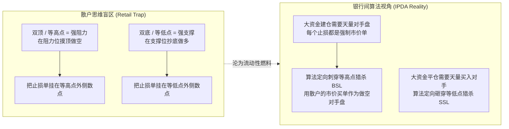
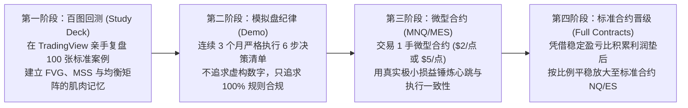

# ICT 2022 Mentorship 终极总结与全体系精要归纳

> **Created by Xiao Ang** · 针对 **2022 ICT Mentorship [No Rant]（全 37 讲）** 打造的交易哲学、实战决策链路、核心技术武器库与系统资产终极指南。

---

## 一、交易底层哲学：算法定价与散户思维的范式转移

传统技术分析（散户思维）与机构订单流（IPDA 算法视角）的核心分水岭在于**对价格运动驱动力的理解**：



### 1. 价格运动的唯一驱动力：两大流动性磁铁 (DOL)
价格从不随机游走，高时间框架（周线/日线）上的价格永远像回形针被磁铁吸引一样，只奔向两样东西：
1. **流动性止损池（Liquidity Pools）**：旧高点上方的**买方止损池（Buyside Liquidity, BSL）**，旧低点下方的**卖方止损池（Sellside Liquidity, SSL）**。
2. **价格失衡区（Imbalance / Fair Value Gap, FVG）**：高动能单边穿透后未完成双向撮合的价格真空，算法必然会在未来适当时段回来**再平衡（Rebalance）**。

### 2. 放弃“高频多空通吃”，专注“日内单波段”
顶尖交易员展示的 1 分钟图高频多空反手依赖极深盘感，极易使普通学习者在震荡噪音中磨损本金。**2022 核心模型的立足之本是：每天只在特定时间窗口，捕捉一段最高确定性、阻力最小的日内主单边价格腿（Intraday Price Leg）**。

---

## 二、一笔标准交易的六阶段实战决策链 (`S1–S6`)

在实盘、模拟或复盘中，必须严格按照以下 6 步决策链逐项打勾，不满足条件绝不开仓：

```text
S1 环境与时间门 ──▶ S2 流动性地图 (DOL) ──▶ S3 猎杀与诱导识别 ──▶ S4 位移与结构扳机 (MSS) ──▶ S5 均衡矩阵挂单 ──▶ S6 止盈与手帐复盘
```

| 阶段 | 核心任务 | 判定标准与执行动作 | 绝对禁止项（陷阱防范） |
| :--- | :--- | :--- | :--- |
| **`S1` 环境与时间门** | 今天/此刻值不值得做？ | ① 锁定纽约时区（`UTC-4 / UTC-5`）；<br/>② 仅在 **早盘 `08:30–11:00`** 与 **下午盘 `13:30–16:00`** 交易；<br/>③ 合约交割周在 Barchart 核对持仓量（H/M/U/Z）完成换月。 | ❌ 严禁在 `12:00–13:00` 纽约午休垃圾时间开新仓；<br/>❌ 严禁在非农前夕等 Seek & Destroy 日逆势死扛。 |
| **`S2` 流动性地图** | 算法今天最想去哪？ | ① 自上而下（`1W → 1D → 1H → 15m`）确认日线偏向；<br/>② 标出未被触碰的 **BSL（前高/等高点）** 或 **SSL（前低/等低点）** 作为日内磁铁（Draw on Liquidity, DOL）。 | ❌ 严禁脱离高周期流动性背景，盲目在 1m 图局部真空区摸顶抄底。 |
| **`S3` 猎杀与诱导** | 算法刚刚诱骗了谁？ | ① 开盘初顺势小破位常为**诱空/诱多陷阱（Sucker Play）**；<br/>② 冲击流动性池时观察是否走出消耗动能的**三推形态（Three Drives）**；<br/>③ 保持 `Wait`，直到预定 BSL 或 SSL 被完全刺穿（Stop Raid）。 | ❌ 严禁在等高点下方提前摸顶做空，将止损设在算法准备引爆的池子里。 |
| **`S4` 位移与结构扳机** | 市场亮出真底牌了吗？ | ① 刺穿止损池后降维到 `5m / 2m / 1m`；<br/>② 等待大实体阴线以“大象跳进儿童泳池”般的**高能位移（Displacement）**干脆击穿最近的短期波段极值（**Bearish MSS / BMS**）；<br/>③ 或位移实体吞没看涨订单块开盘价，完成**交付状态转变（Change in State of Delivery）**。 | ❌ 刺穿高点后若回落软绵绵无速度、无位移、无 FVG，必须继续按兵不动。 |
| **`S5` 均衡矩阵与挂单** | 在哪里挂限价单？ | ① 从位移波段起点拉到终点，取 `0.5` 均衡中轴（Equilibrium）；<br/>② **做空仅限 `>0.5` 溢价区（Premium）** 回抽看跌 FVG 时挂限价单；<br/>③ **做多仅限 `<0.5` 折价区（Discount）** 回踩看涨 FVG 时挂限价单；<br/>④ 止损设在猎杀波段最高点上方（或位移大 K 线极值上方）。 | ❌ 严禁在 `<0.5` 折价区追空，或在 `>0.5` 溢价区追多；<br/>❌ 严禁因害怕踏空（FOMO）在位移末端市价追单。 |
| **`S6` 止盈与复盘** | 怎么分批落袋与沉淀？ | ① **第一目标（内部流动性 IRL）**：跨过 `0.5` 中轴对侧的首个内部反向 FVG 平掉 50%–70% 仓位；<br/>② **终极目标（外部流动性 ERL）**：余仓看下方对侧波段低点 Sell Stops；<br/>③ 收盘按 Ep.04 四维手帐记录：耗时、点差（Handles）、抗单浮亏（Heat）与折算美元。 | ❌ 严禁在溢价区贪心不肯分批止盈；<br/>❌ 严禁一笔止损后情绪失控报复性加仓。 |

---

## 三、ICT 2022 全 37 讲十二大高阶核心武器库

在全 37 讲中，ICT 在基础模型之上扩展了一系列机构级高阶工具，构成了不可替代的技术武器库：

| 武器概念 | 核心原理解析 | 对应集数与实战抓手 |
| :--- | :--- | :--- |
| **1. Power of 3 (AMD)** | 经典日 K 线形成模型：以**纽约午夜 00:00 开盘价**为界，开盘后先在开盘价反向实施操纵（Judas Swing 形成当日极值），再展开顺势大单边派发（Distribution）。看空只在开盘价上方做空，看多只在开盘价下方做多。 | **Ep.09 / Ep.37**<br/>`ep09_power_of_3_amd_schema.png` |
| **2. 经济日历时间扳机** | ForexFactory 红色高影响事件（CPI/非农/PPI）不是方向预测工具，而是**算法快速注入波动性完成流动性猎杀的时间契机**。08:30 数据脉冲造假，09:30 开盘亮真招。 | **Ep.10**<br/>`ep10_economic_calendar_830_spike.png` |
| **3. 三层分形市场结构** | **LTH（长期） / ITH（中期） / STH（短期）**。ITH 是回抽高周期 FVG 形成的波段节点，**保护性止损只允许移动至已确认的 ITH 之外**，切忌在微观 STH 随意上移止损被打掉。 | **Ep.12 / Ep.13**<br/>`ep12_market_structure_hierarchy.png` |
| **4. 多重 FVG 筛选法则** | 单边浪连续出现多个 FVG 时：① 过滤掉低于 50% 的劣质缺口；② 优先选择与前期订单块开盘价共振的 FVG；③ 优先在深度溢价区最深处的 FVG 入场以博取极致盈亏比。 | **Ep.14**<br/>`ep14_live_execution_fvg_run.png` |
| **5. 盘口走盘与 CE 中轴** | FVG 的 50% 中轴被称为 **Consequent Encroachment (CE)**。若反弹柱体无法以实体收盘站上 CE，代表多头衰竭，空头算法将在此处毫秒级接管下砸。 | **Ep.15 / Ep.25**<br/>`ep15_fomc_tape_reading_fvg.png` |
| **6. 外汇与 DXY 镜像联动** | 外汇直盘与美元指数共用 IPDA 定价逻辑。DXY 向上刺穿 BSL 遇阻时，EURUSD/GBPUSD 同步向下刺穿 SSL 进折价区，双向背书下胜率倍增。 | **Ep.08 / Ep.17**<br/>`ep08_forex_3m_fvg_discount.png` |
| **7. 跨市场 SMT 背离** | **Smart Money Technique**：在同向联动的指数（ES / NQ / YM）拐点对比，若 ES 突破前高而 NQ 拒绝突破前高，揭示机构暗中出货，做空应优先做空弱势品种（NQ）。 | **Ep.22 / Ep.35**<br/>`ep22_smt_divergence_es_nq.png` |
| **8. 平衡价格区间 (BPR)** | **Balanced Price Range**：当快速看涨 FVG 与紧随其后的快速看跌 FVG 发生交叉重叠时，重叠区间已被双向重新平衡，未来回踩该区间将构成极坚硬的阻力铁板。 | **Ep.30**<br/>`ep30_fed_chair_volatility_ob.png` |
| **9. 15m 与 1m 分形嵌套** | 当 15m/5m FVG 过于宽大（如 30–50 点）时，等价格刺入缺口 50% CE 内部，切入 1m 图寻找微观 MSS + 1m FVG 进场，将止损压缩至 5–8 点，大幅拉升盈亏比。 | **Ep.32**<br/>`ep32_outside_day_50_equilibrium.png` |
| **10. 跨日流动性地图** | 每天盘前必标**前日最高价 (PDH)** 与 **前日最低价 (PDL)**。早盘开盘价若临近 PDH/PDL，算法极大概率先去刺穿扫除昨日保护止损，再开启反转或单边。 | **Ep.34**<br/>`ep34_opening_price_order_block.png` |
| **11. 绞肉机日识别** | **Seek & Destroy**：开盘先扫前高回中轴、再扫前低拉回中轴且均无跟随（常见于非农前夕）。一旦在 10:00 前发现该形态，**立即关机观望，全天 0 交易**。 | **Ep.35**<br/>`ep35_smt_ob_continuation.png` |
| **12. 亏损后风控降档铁律** | 连续遭遇 2–3 笔止损后，**下一笔交易必须将单笔风险敞口砍半（仓位砍半）**！直到用减半后的仓位赢回前次亏损额的一半以上，才允许恢复标准仓位。 | **Ep.33**<br/>`ep33_fvg_imbalance_target.png` |

---

## 四、全套交付资产与系统入口导航

本套系统实现了「讲义文档 + 高清原图 + 原生 macOS 桌面 App + 个人文档网站 + 智能 Agent 技能」五位一体的完整闭环：

| 资产维度 | 本地路径 / 访问链接 | 说明与使用方式 |
| :--- | :--- | :--- |
| **桌面原生应用** | `/Users/rouen/Desktop/ICT 2022 学习室.app` | 双击即用，包含全 37 讲三层提炼卡片、62 张高清原图放大浏览、YouTube/B站双跳秒、答题练习与复盘手帐双写落盘 (`notebook.json`)。 |
| **图文完整精读讲义** | [`ICT_2022_全37讲_图文精读手册.md`](file:///Users/rouen/.gemini/antigravity/scratch/ict-2022-mentorship/ICT_2022_全37讲_图文精读手册.md) | 本地工作区核心 Markdown 讲义（56.5 KB，1,123 行），涵盖全 37 讲逐集深度剖析与避坑指南。 |
| **62 张 1080p 关键帧图库** | `study-room/lesson-assets/` | 零本地 MP4 冗余占用，通过流媒体按秒精确定位截取，批注清晰、无损无水印。 |
| **学习室工作台源码** | `/Users/rouen/.gemini/antigravity/scratch/ict-2022-mentorship/study-room` | 纯原生 HTML/CSS/JS + Cocoa Swift 架构，直接修改后运行 `./native/build.sh` 即可一键更新 App。 |
| **GitHub 开源仓库** | [`https://github.com/Rouen007/ict-2022-study-room`](https://github.com/Rouen007/ict-2022-study-room) | 已推送至 `main` 分支（Commit `84b02de`），公开分享给社区，Clone 后即可开箱即用。 |
| **个人知识库网站专栏** | [`https://github.com/Rouen007/rouen-docs-site`](https://github.com/Rouen007/rouen-docs-site) 的 `/kol/ict/` | 网页端已集成 `full-handbook.md` 与全部 62 张图片，通过 VitePress 安全守卫并成功推送到远程 `main`。 |
| **Agent 专属技能 (Skill)** | `ict-2022-study-room` | 已同步至本地 4 大配置目录（`.gemini`、`.agents`、`.claude`、`.codex`），对话中随时调用进行复盘点评与答疑。 |

---

## 五、职业晋级路线图（One Model for Life）

> “你不需要掌握市面上的一百种指标和策略，只需要把这套 **ICT 2022 交易模型** 练到极致，它就足以支撑你一生的职业交易生涯。” —— ICT


