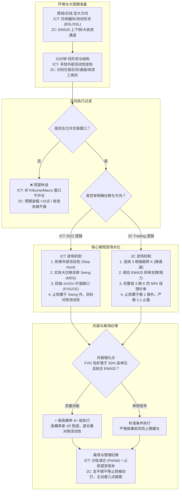

# ICT 2022 vs 2C Trading 跨体系深度对比与互补融合手册

> **编制声明**：Created by Xiao Ang · 跨体系对照研学手册  
> **数据源与文献出处**：  
> - **ICT 2022 Mentorship**：SirTrader No-Rant 37 讲校对原稿、YouTube @InnerCircleTrader 原片关键帧及官方概念。  
> - **2C Trading**：YouTube @2C_trading（170+ 实盘与教学视频，2025.03–2026.08），本地系统位于 `Documents/trading-notes/methodology/2C_trading_system/`。  
> **严正隔离边界**：2C Trading 基于 Al Brooks 价格行为学（Price Action），**属于外部对比与补充视角，严禁混淆为 ICT 官方原话或核心教条**。

---

## 一、跨体系决策流程图 (Mermaid)

---

## 二、底层哲学：央行算法假说 vs 市场概率期望

| 比较维度 | ICT 2022 Mentorship | 2C Trading (Al Brooks 体系) | 实践反思与认知互补 |
| :--- | :--- | :--- | :--- |
| **底层驱动假说** | **IPDA (Interbank Price Delivery Algorithm)** 认为价格受央行算法精准控制，走势旨在清扫未成交订单池（Buy/Sell Stops）与重平衡公允价值缺口。 | **市场微观结构与博弈概率** 认为价格是不同周期买卖双方博弈与机构建仓痕迹的反映，追求在统计优势形态上以概率取胜。 | ICT 提供了极佳的**宏观剧本与目标锚点**；2C 提供了清醒的**概率思维与试错容忍度**，避免因过度迷信“算法必然性”而在反向走势中死扛。 |
| **盈亏比与胜率** | **追求非对称高 R:R（1:3 至 1:5+）** 以小止损换取日内甚至跨日的大波段目标池，接受较低的理论胜率。 | **追求高胜率（80%+）与稳健 1R** 23天实盘测试：36笔交易，82%胜率，2.2均R。做的是概率，不强行死磕超高盈亏比。 | 初学者往往因过度追求 ICT 的“神级盈亏比”而频繁被扫止损或坐过山车；引入 2C 的 1:1 稳态逻辑，有助于初期建立稳定的资金曲线。 |
| **开单与放弃哲学** | 严格锁定纽约早盘（08:30–11:00）与午后盘（13:30–15:30），但日内可能在 1m 图上寻找多次 FVG 入场。 | **“最好的交易是什么都不做的 4 天”** 放弃机会比抓住机会更重要。一天均 1.5 笔交易；日内波幅 <15 点直接休息，不强迫开单。 | 两者在“克制交易”上高度一致，2C 的 10 条反规则黑名单极大增强了日内防御壁垒。 |

---

## 三、核心进场形态微观深度拆解

### 1. ICT 2022 的 FVG (Fair Value Gap) 价值缺口
- **三根 K 线几何形态**：
  - K线 1（前导柱）、K线 2（大实体强位移柱）、K线 3（跟随后续柱）。
  - 看跌 FVG：K线 3 的最高价（High）未能触及 K线 1 的最低价（Low），中间留出真空空白区间。
  - 看涨 FVG：K线 3 的最低价（Low）高于 K线 1 的最高价（High）。
- **交割逻辑**：算法在单边单向报价（One-sided Delivery）后留下的失衡，必须回抽（Rebalance）至缺口或其中点（Consequent Encroachment, 0.5 CE）才算交割完整。
- **入场与止损**：在价格进入 FVG 时触价限价或收盘确认做空/多，止损设在位移起点或摆动高低点外。

### 2. 2C Trading 的 3 根 K 微通道与 50% 挂单 (3-Bar Micro Channel Scalp)
- **三根 K 线几何形态**：
  - 在既定通道内，连续出现 3 根（或 4–5 根）强趋势 K 线（大实体、收盘在极值、下影线极短或没有）。
  - 拉出整组 3 根 K 线从最低到最高的 50% 几何均分位。
- **博弈逻辑**：
  - **未破 50% 极强**：若价格仅小幅回撤未跌破 50% 即弹起，说明机构在极高位置积极承接，后续走势爆发力极强。
  - **跌破 50% 极弱**：若价格跌破 50% 甚至创出反向新低，说明多头推力不足，该形态宣告失败。
  - 机构建仓阶梯：第一波买家在 30%，第二波在 50%，第三波在 60%。
- **入场与止损**：
  - 在 3 根 K 线的 50% 回调位提前挂限价单（Limit Order）。
  - 止损严格放在第 1 根 K 线起点外 1 tick。
  - 止盈严格设定 1:1（1R），绝不贪大。
  - **必须由 EMA20 动态均线辅助**：K 线顺着 EMA20 斜率且贴近均线时胜率最高；若 K 线已大幅远离 EMA20 则容易被拉回均线。

### 3. 跨体系共振的“黄金重合区”
当我们在图表上同时审视这两个体系时，会发现惊人的**几何与结构共振**：
> 当 ICT 的位移 K 线形成的 FVG，其中点（0.5 CE）恰好与 2C 的 3 根连续趋势 K 的 50% 回调位重叠，并且该位置恰好贴近 5 分钟图的 EMA20 动态均线时——
> **此时构成了算法再平衡、机构限价单密集承接、均线趋势动量的三维合流点！**

---

## 四、执行周期与过滤器：1 分钟图之争

| 体系 | 对执行周期的态度 | 理论原因 | 实践警示 |
| :--- | :--- | :--- | :--- |
| **ICT 2022** | 提倡 HTF (1D/1H/15m) → LTF (1m/2m) | 1m 图能将止损压缩到 5–10 点内，从而在奔向对侧流动性时拉出 1:5+ 的极大盈亏比。 | 1m 图充斥着大量的伪位移与微型流动性清扫，极易导致交易者误把随机波动当成 MSS，引发过度交易与频繁滑点。 |
| **2C Trading** | **铁律第 4 条：坚决反对 1 分钟图** | 1m 图没有任何实质好处，过早进场导致被频繁洗盘扫损。主战场必须是 5 分钟图，15 分钟看大形态。 | 5m 图过滤掉了大部分微观虚假信号，每根 K 线的开高低收具有更高的统计稳定性。 |

**针对学员的融合实战建议**：
1. **新手与稳定期前**：强烈建议以 **2C 的 5 分钟图为主战场**，在 5m 上寻找 ICT 的 FVG 与 3 根 K 50% 挂单，彻底放弃 1 分钟图。
2. **成熟与盘感建立后**：可在 5m 结构确认后，仅在 ICT 关键时间窗口内使用 1m/2m 进行入场微调，但止损仍需参考 5m 摆动边界。

---

## 五、离场哲学与风控铁律：不等止损的主动防御

### 1. 2C Trading 的铁律级离场纪律
- **“走不顺就离场”**：不等止损被动触发，主观判断走势不流畅、回踩跌破 50% 且迟疑不拉起，差 2–3 个 tick 也必须主动平仓出场！
- **“一倍止盈概率高，两倍概率低”**：高概率机会坚定吃 1R，不赌暴利。
- **“连续亏损就关电脑休息”**：止损被连续打 2 次，说明今日位置或市场环境不对，缩小仓位或彻底休息。

### 2. ICT 2022 的保护机制
- **分批减仓（Partial Take Profit）**：触及第一目标（如内部流动性或 1:2 R:R）立即减仓 50%–80%，并将剩余仓位止损移至保本（Breakeven, BE）。
- **取消未触发计划**：纽约早盘未在 11:00 前触发的限价单必须全部撤销，严禁在午休垃圾时间被动成交。

---

## 六、2C Trading 10 条反规则黑名单与 ICT 规则映射

| # | 2C 禁忌（反规则） | 2C 核心口诀 | ICT 2022 对应映射与防范原则 |
| :-: | :--- | :--- | :--- |
| **1** | **不追涨杀跌** | 高开不追多，低开不追空；宁可错过不可做错 | 严禁在溢价区（>0.5）追买，严禁在折价区（<0.5）追空 |
| **2** | **不在交易区间中间做** | 只做区间边缘，中间是死区 | 震荡市中等高/等低点（EQH/EQL）中间是订单绞肉机，必须等扫盘 |
| **3** | **收敛三角形不做** | 收敛=末端萎缩观望，绝不左侧开仓猜突破 | 收敛三角形往往是 Seek & Destroy 市场，等待真实单向位移确认 |
| **4** | **不看 1 分钟图** | 1分钟全是噪音，过早进场必被打损 | 初学阶段避免在 1m 图迷失；以 15m/5m 结构为准 |
| **5** | **不加仓** | 盈利加仓=重仓=灾难，一次回调直接穿仓 | 一笔交易一次计划，单笔风险严格限制在 1%–2% 以内 |
| **6** | **不改止损** | 进场前算好止损，中途改大一次亏 2.5R | 止损置于失效点后神圣不可侵犯，绝不因侥幸心理拖大止损 |
| **7** | **低波动日不做** | 日内预期波幅 <15 点直接回家休息 | FOMC、非农前半日或日历空白无驱动日，不强行榨取利润 |
| **8** | **不跟第三推对抗** | 交易区间内第三推形成趋势时立刻离场，绝不逆势 | 三推往往伴随单向算法推进，出现持续位移时不逆势猜顶底 |
| **9** | **强趋势不做反转** | 强单边趋势中顺势做，不做第 1 次反转 K | 强趋势中的首个逆向 FVG 往往只是回踩陷阱，继续顺大周期偏向 |
| **10** | **不强迫开单** | 最好的交易是什么都不做的 4 天 | 宁可整周 0 交易，绝不为了“有事做”而开低质量边际单 |

---

## 七、2C Trading 2026 最新 YouTube 视频实盘要点与前沿演进（2026-09 至 2026-10）

> **最新核对源**：通过本地 `faster_whisper` 逐字转写核对 2C 官方最新实盘视频：  
> - **视频 1**：`4zkG0jdEsy8`（2026-09-07 · 26分09秒）《🚀实盘中如何快速找到支撑阻力🎯》  
> - **视频 2**：`zDCnoIImHHM`（2026-10-21 · 23分37秒）《🚀随缘更新🎯解释最近为什么没更新--20261021》

### 1. 支阻区域论与做空被套反转支撑（Trapped Traders Order Flow）
- **核心机制**：支阻是“区域 (Zone)”而非单一水平线，不要死扣单根 tick。当关键位置的做空尝试失败（例如 K14 出现大阳线暴力包吞向上），被套的空头会在价格再次回踩其进场点时急于**保本离场（买入平仓）**，同时场外多头敏锐入场，**多头买盘 + 空头平仓买盘合流**，直接将原本的破位点打造成极坚硬的支撑位！
- **与 ICT 订单块/突破块 (Breaker) 的神级共振**：Al Brooks 的“被套反转”与 ICT 的“流动性猎杀后订单块缓解（Mitigation）”底层机理 100% 相同。

### 2. 交易区间中 3 根 K 50% 挂单的【核心禁用禁忌】（2026-10-21 警示）
- **最新重要例外规则**：在强阳强阴交替的震荡交易区间（Trading Range）或收敛整理内部，**严禁使用 3 根 K 线的 50% 挂单入场**！
- **原因**：区间内缺乏单向动量，价格会发生深幅甚至刺破前低/前高的回撤，极易打穿 1 tick 窄止损后再拉起。3 根 K 50% 挂单必须严格限制在**清晰的趋势通道或突破后单边推进**中。
- **交易区间三分法**：上 1/3 区域做空指盈，下 1/3 区域做多指盈，中间 1/3 是噪音死区严禁开单。

### 3. 仓位放大后彻底退出 1 分钟图的心理学根源
- **1 分钟图的毒性**：1m 节奏过快，练习量不够时思考时间极度匮乏，极易导致动作变形。连续止损后引发报复性重仓、纪律崩溃。
- **成熟阶段的收敛**：随着资金量与单笔合约仓位变大，彻底退出 1m 图，**坚定只做 5 分钟图剥头皮**，偶做波段，日均交易笔数显著减少，宁缺毋滥。

### 4. 预期不顺果断平保（BE）主动跑与单日双损熔断
- **平保主动撤离**：入场后期待价格立刻按预期顺滑推进；若反向迟疑收大实体反向阳线，说明逻辑不对，**只要市场给平保（BE）机会立即平仓跑路**。
- **单日熔断与心态心法**：一单亏损+一单平保，若后续市场仍是窄幅纠结区间（全天仅 29 点波幅），果断收工关电脑，绝不强行交易。**“涨上去就涨上去呗，涨上去又不赔钱”**。

---

## 八、2C Trading 经典专题精读（Wedge 楔形、波段 Swing、剥头皮 Scalp）

### 1. Wedge（楔形与三推结构）
- **动能竭尽本质**：楔形（3-Push / Wedge）本质是动能竭尽（Exhaustion）。
- **实战预期控制**：切忌执念于“V 型大反转”；在趋势行情中，楔形反转通常只产生**小波段修正**（如回测 EMA20 或走出 2 条逆势小腿 TBTL - Two-legged correction）。
- **顺大逆小中的楔形旗形（Wedge Flag）**：强下跌趋势中出现的向上楔形，是教科书级别的高盈亏比顺势空点；强上涨中的向下楔形则是顺势多点。
- **进场与止损**：等待二次确认（Second Entry），等回踩不破极值后收出反向信号 K 进场；止损锚定在第三推极值外侧 1 tick。

### 2. 波段交易（Swing Trading）
- **核心定位**：“几次剥头皮不如一笔波段”。剥头皮摩擦成本与心理损耗极高；波段捕捉 5 分钟级别趋势推进（10~30 点 SPX / 40~100 点 NQ），具有更高的容错与盈亏比（2R~4R+）。
- **复合仓位管理**：入场后分成两部分（如 70% 剥头皮仓位在 1.5R/第一阻力位快速止盈保本，30% Runner 仓位以波段波谷 Higher Low 跟踪让利润奔跑）。

### 3. 高胜率剥头皮（Scalping）与 3 Bars Limit
- **微通道 3 根 K 50% 挂单法**：单边微通道连续出现 3 根实体饱满、几乎无反向重叠的同向 K 线后，在整段 3 根 K 50% 回撤处挂限价单顺势入场，止损置于启动点外 1 tick，快速兑现 1R~1.5R。
- **核心禁忌**：严禁在横盘整理或强阴强阳交错的震荡交易区间中使用。

---

## 九、Junkman 老师（JM 体系）图文方法论与三方体系融合

Junkman 老师（夜航社 JUNK 体系）以**事前期权 GEX 节点为地图、纯价格行为（PA）为扳机、空间盈亏比为否决权**。

### 1. 地图语言与节点认知（避免误用）
- **黄线 / 金线**：高优先级观察反应位，而非预设立场的必涨必跌点，更不能盲目当作止盈目标（实测价格到黄线常只行至半程）。
- **正/负 Gamma 环境**：正 Gamma Dealer 反动量对冲（磨盘吸附、收缩）；负 Gamma 顺动量对冲（位移加速放大，但不预测方向）。

### 2. 核心执行状态机：B / T / E / S
突破本身只是事件，突破后的**接受程度**才决定能否交易。
- **B (Boundary 结构边界)**：必须被大实体有效突破并在回踩时测试的区域。
- **T (Test 测试极值)**：整段回踩过程中触及的最远测试端点。
- **H / L (微型触发结构)**：T 点确认后，重新沿突破方向启动时必须突破的局部微高点/微低点。
- **E (Entry 入场点)**：H/L 被突破时的计划成交价。
- **S (Stop 硬止损)**：放置在测试极值 T 外侧的安全防线。

### 3. 结构化三层剧本表分工铁律
- **层① 先验（GEX / 节点地形）**：决定当天大概率走哪种剧本及概率分布（如 A 磁吸 50%、B 收敛 30%、C 破位 15%、D 突破 5%）。**绝不能拿来做进场扳机**。
- **层② 扳机（纯价格行为 PA）**：收复、站稳、跌破、反抽受阻；必须由 K 线实体确认哪个剧本激活。
- **层③ 否决（空间 R）**：$\text{Space R} = \frac{\text{第一真实目标} - E}{E - S}$；若不足 1.5R~2R 严格否决不开单。

---

## 十、三大体系全景交汇对比图谱（ICT × 2C × Junkman）

| 维度 | ICT 2022 Mentorship | 2C Trading (Al Brooks 派生) | Junkman 体系 (JM 结构) |
| :--- | :--- | :--- | :--- |
| **底层世界观** | 算法驱动、流动性猎杀、做市商订单传递 | 市场买卖双方心理博弈、被套交易者（Trapped Traders）平保流动性 | 期权做市商对冲机制（GEX Gamma）、大单清算与筹码吸附 |
| **关键观测位置** | FVG、订单块 (OB)、流动性池 (BSL/SSL)、0.5 均衡位 | 支阻区域 (Zone)、微通道、EMA20、交易区间 1/3 边界 | Call/Put Wall、黄紫线反应节点、POC、VWAP、Midnight |
| **入场扳机** | 猎杀后 MSS 位移 ➔ 回抽 FVG 折溢价限价进场 | 5m K 线信号（反转吞没、三推楔形竭尽、3 根 K 50% 限价） | B 边界大实体突破 ➔ 回踩形成 T ➔ 突破微型 H/L 触发 E |
| **时间维度** | 严格 Killzones (08:30-11:00, 13:30-16:00, Macro 窗口) | 开盘前 15 分钟定势，盘中耐心等待高质量 5m 结构 | 开盘 9:45-10:20 N 字定型，午间 11:30 降频，尾盘 MOC 剧本 |
| **核心禁忌** | 无 MSS/FVG 盲目摸顶摸底，在平衡区中轴乱开单 | 交易区间内使用 50% 挂单，1m 频繁冲动开单，追高追低 | 凭线直接开单（跨层）、买入后浮亏扛单、盈亏比不足强行入场 |

---

## 十一、总结与跨体系协同行动指南

1. **认知分离**：在 ICT 2022 学习室中，将 2C Trading 定位为**微观执行与概率防御的辅助镜**，将 Junkman 体系定位为**宏观做市商筹码分布与三层剧本的沙盘地图**。
2. **各取所长**：
   - 用 **Junkman 体系** 构建**宏观期权地形**（GEX 节点、正负 Gamma 波动率预期、三层剧本概率分布与空间 R 否决门）；
   - 用 **ICT 2022** 构建**空间坐标系**（BSL/SSL 流动性池、Dealing Range、0.5 均衡、FVG 价值失衡）与**时间坐标系**（NY Killzones & Macro Windows）；
   - 用 **2C Trading** 构建**微观入场扳机**（5m 3根K 50% 挂单、三推楔形竭尽识别、EMA20 贴合加速）与**铁律防守网**（5m 防噪、1:1 稳态锁定、走不顺主动跑、10 条黑名单反规则、区间内禁用 50% 挂单禁忌）。
3. **图文沉浸**：结合学习室 View 03 中的「外部对比视角」面板与实盘关键帧，反复在图表上复核两者的重合案例。
