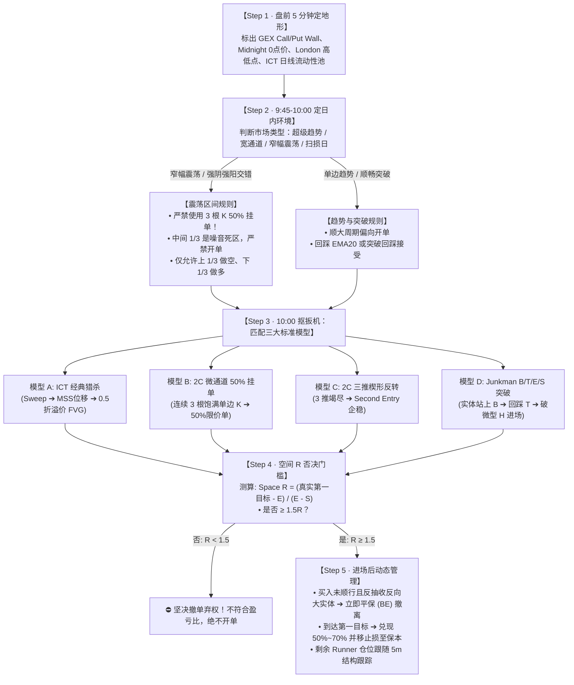

# 跨体系极速研学决策树与原子卡片速查表
## —— ICT 2022 × 2C Trading × Junkman 体系 60 秒极简决策与靶场盲练指南

> **编制宗旨**：告别数百小时音视频与海量笔记的认知过载，实现**“更快、更精”**的极速研学闭环。  
> 核心逻辑：**一张 60 秒决策树晨会自检 + 五张原子执行卡片（肌肉记忆）+ 盲图 30 秒快练法 + 反规则秒杀过滤器**。

---

## 🚀 第一部分：60 秒日内极简决策树（晨会与盘中自检）



---

## ⚡ 第二部分：五大核心原子卡片（每张卡不超过 6 行，直接背诵）

### 🎴 原子卡 01：ICT 2022 经典算法流动性猎杀模型
```text
【适用环境】纽约早盘 09:30–11:00（或 10:00 Macro 窗口），外围高低点未被清扫。
【图表特征】价格快速刺穿前期显著等高/等低点（BSL/SSL），随即收出长影线并发生剧烈位移（Displacement）。
【入场条件】位移击穿近期反向波段点完成 MSS，价格回抽至该位移段 0.5 均衡位以外的 FVG 缺口，限价成交。
【止损设置】严格置于猎杀极值（Swing High/Low）外侧。
【第一目标】对侧未回补的内部流动性池或反向 FVG（至少 1:2 R:R）。
【致命禁忌】位移无大实体、未破坏任何反向结构时盲目猜顶猜底；午休 12:00–13:30 垃圾时间追单。
```

---

### 🎴 原子卡 02：2C 微通道 3 根 K 50% 回撤限价模型
```text
【适用环境】清晰的单边强趋势微通道（Micro Channel）或大区间突破后的首波爆发期。
【图表特征】连续 3 根同向 5m K 线，实体饱满，几乎无重叠，紧贴单侧推进。
【入场条件】第 3 根收盘后，立即在整段 3 根 K 线总波幅的 50% 黄金回撤位挂限价单（Limit Order）。
【止损设置】微通道启动点或前一根 K 线极值外 1 个 tick（超紧窄止损）。
【第一目标】顺势 1:1 到 1:1.5 快速落袋，高概率稳态取利。
【致命禁忌】震荡整理、强阳强阴交替区间【绝对禁用】！区间内回撤极深，必打损再反弹。
```

---

### 🎴 原子卡 03：2C 三推楔形（Wedge / 3-Push）动能竭尽模型
```text
【适用环境】趋势延伸末端，或开盘 9:30–10:15 连续出现三次同向脉冲。
【图表特征】高低点逐步抬高/降低但斜率变缓，K 线实体逐渐缩小、引线增多，呈现收敛楔形。
【入场条件】第三推刺破前高/前低后无法延续，等待二次确认（Second Entry）出现反向反转 K 线收盘进场。
【止损设置】第三推的最高点/最低点外侧 1 个 tick。
【第一目标】务实锁定回测 EMA20 或楔形起点，不盲目幻想大单边反转；强趋势中作为旗形顺势做中继。
【致命禁忌】第一推刚出来就逆势接飞刀；在第一根反向十字星急躁进场。
```

---

### 🎴 原子卡 04：Junkman B / T / E / S 结构突破回踩模型
```text
【适用环境】开盘 5m 形成清晰箱体边界（B），或 GEX 核心大节点（CW/PW）被大实体穿越。
【图表特征】5 分钟实体完整收在 B 边界外侧 ➔ 价格反向回踩 B 但无法重新接受旧箱体，打出测试极值 T。
【入场条件】T 点确认后，价格重新启动并突破回踩期间形成的微型高点 H（空头则破微型低点 L），在 E 成交。
【止损设置】刚性置于测试极值 T 外侧（硬止损 S）。
【第一目标】入场方向上的第一个真实阻碍（Fresh 大 GEX 节点、VWAP 或盘前极值）。
【致命禁忌】凭黄线紫线直接盲目开单（先验跨层做扳机）；买入后陷入浮亏不平仓扛单。
```

---

### 🎴 原子卡 05：超级趋势日 VWAP 顺势推进模型
```text
【适用环境】London Low 守住 Midnight 0 点价 + 处于正 Gamma 环境 + 开盘价远高于 Midnight。
【图表特征】开盘单边缓步上行，全天回踩极浅，波动率收敛。
【入场条件】9:45–10:00 第一次回踩 VWAP 企稳收阳，直接买入顺势仓（Anchor Strike）。
【止损设置】跌破 VWAP 且反抽不过立即硬止损。
【第一目标】日内最大正 Gamma 壁垒（CW），慢磨行情不轻易下车。
【致命禁忌】误当成震荡市逆势做空；由于嫌涨得慢在半途因恐高而反复下车甚至反手。
```

---

## 🎯 第三部分：30 秒盲图极速刷题法（Blind Chart Drill SOP）

每天不要花几个小时泡在视频里，用以下 **30 秒盲图四步法**，每天练习 5 张图，2 周即可建立专业交易员的盘感肌肉记忆：

```text
┌────────────────────────────────────────────────────────┐
│                   30 秒盲图极速刷题四步法                  │
├────────────────────────────────────────────────────────┤
│ 1. 遮挡右侧（5秒）：遮住右半边走势，冻结当前决策时点。   │
│ 2. 环境定性（5秒）：趋势？区间？扫损？还是噪音？        │
│ 3. 极速自问（10秒）：                                  │
│    Q1：当前有无 B / FVG / 3 根 K 明确结构？            │
│    Q2：现在是挂单、等收盘、还是坚决放弃？              │
│    Q3：止损在哪？第一目标在哪？R 够 1.5 吗？           │
│ 4. 揭晓核对（10秒）：移开遮挡，复核实盘走势：          │
│    • 答对：记录正反馈；                                │
│    • 答错：写入错题本（是环境看错？还是抢跑入场？）。 │
└────────────────────────────────────────────────────────┘
```

---

## 🛑 第四部分：反规则秒杀过滤器（一票否决黑名单）

只要命中以下任何一项，**立即关闭交易软件离开电脑，不进行任何交易**：

| # | 触发条件 | 动作与处理 |
| :-: | :--- | :--- |
| **1** | **日内预期波幅 < 15 点**（死鱼行情） | **整天弃权**，不浪费精力在垃圾时间。 |
| **2** | **距下方/上方最近大黄线 < 5 点** | **无空间弃权**，价格即将撞墙，盈亏比极差。 |
| **3** | **强阴强阳交错的震荡区间** | **严禁挂 3 根 K 50% 限价单**，必须等扫盘或边缘进场。 |
| **4** | **买入后未立即顺行、反抽收反向大阳线** | **立即平保（BE）跑路**，绝不坐以待毙等打止损。 |
| **5** | **连续遭遇 2 笔止损** | **触发日内熔断**，关电脑休息，绝不报复性重仓开单。 |
| **6** | **开盘前 5 分钟（09:30–09:35）** | **执行静默**，只看不做，避开做市商开盘暴力洗盘。 |
| **7** | **未发生流动性猎杀或 MSS 位移** | **不做左侧摸顶摸底**，市场证明它要转折前不猜转折。 |
| **8** | **测算 Space R < 1.5R** | **坚决撤单**，盈亏比不够的“好形态”也是劣质交易。 |
