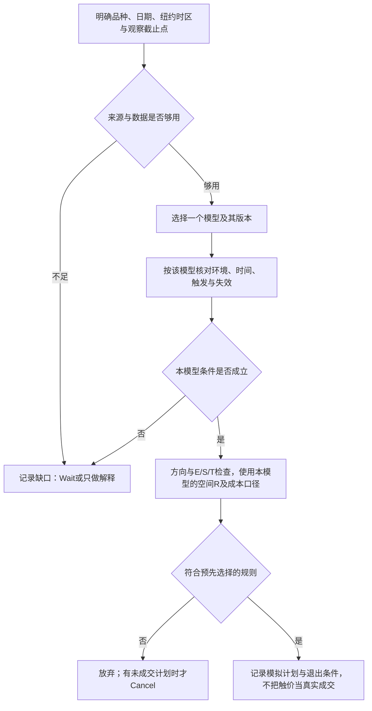

# 跨体系速查卡与盲图训练

> 2026-10-26整理。保留ICT、2C、Junkman五张卡片的学习主题；以下是模型检查清单，不是五套已验证交易指令。先读 [跨体系使用规范](cross-framework-guide.md)。原“极速决策树”全文保留在 [历史原稿](_archive/20261025-before-skill-consolidation/跨体系极速决策树与原子卡片速查表.md)。

## 60秒检查树



60秒只是练习节奏。当前基础训练时间读framework.json；外部模型的时间限制需另有出处。Macro与GEX位置只提供观察信息，不代替所选模型触发。

## 五张选学卡

### 卡01 · ICT 2022清扫—结构—FVG

```text
模型：ICT学习室当前训练版本；具体原课归因另查证据。
环境：声明候选流动性、所选区间、周期与当前允许时段。
确认：清扫、位移、MSS、已完成三根K线的FVG分别记录。
计划：先冻结区间锚点；限价触价与收盘确认选一种，不临时切换。
风险：明确E/S/T、取消与退出；目标按计划，不统一套用其他模型的R门槛。
缺口：原稿或图表证据不足时Wait；不宣称清扫后必然反转。
```

### 卡02 · 2C三根K微通道50%候选模型

```text
模型：外部材料中的选学候选；三根K范围、周期与原例条件待逐项核读。
环境：先区分趋势／通道与交易区间，不能只数同色K线。
坐标：整组三根K的50%不是FVG的CE，也不是任意大区间均衡。
触发：记录所选入场方式、可见回撤及失效，禁止凭摘要补造成交。
管理：1R或其他目标必须与该版本一致；统一≥1.5R约束会过滤1R方案。
缺口：止损外1tick及禁用条件需核品种与出处，不跨标的照搬。
```

### 卡03 · 2C楔形／三推候选模型

```text
模型：外部形态选学；不把三次推进直接当成反转已确认。
环境：区分顺势旗形、逆势修正与反转假设，先写当前背景。
确认：按所选原例定义结构和Second Entry，不将任意第二次触碰代替。
计划：记录信号、失败边界与可达目标，不事后改写为大反转模型。
管理：止损与第一目标遵循该模型版本，不能临时换ICT的持仓规则。
缺口：缺出处或确认不足时仅标观察，不强行给Execute。
```

### 卡04 · Junkman地图—PA—空间检查

```text
模型：本学习室的对照卡；正式定义查Junkman专用指南与原图。
地图：记录节点来源、市场日期与新鲜度，不凭颜色或墙单独给方向。
扳机：边界B、测试T、微型结构与E/S按该模型原定义逐项核对。
否决：先验证多空E/S/T方向，再检查本版本的第一目标与空间。
管理：已有持仓的Exit与未成交挂单的Cancel分别处理。
缺口：节点、消息或原图缺失时保持待证据，不补造剧本概率。
```

### 卡05 · VWAP顺势／趋势日研究假设

```text
模型：主模型提出的研究候选，尚无本项目逐条证据链。
环境：Midnight、London与Gamma只是待检变量，不共同保证趋势日。
确认：须有当前可见价格路径和所选触发；不能由日终趋势反推早盘可知。
风险：事先定义失效、E/S/T、成本、执行与退出，证据不足时不生成计划。
验证：同时采集失败、区间、无交易样本，避免只挑单边成功日。
状态：仅用于观察与研究，不作为已核验作者规则或基础评分标准。
```

## 30秒盲图法

1. 遮住未来，冻结时点；记录所选模型与证据来源。
2. 判断环境，并指出缺少什么；允许结论不确定或无交易。
3. 给出当前可支持的动作、确认／失效与风险坐标，不追求赶时间凑答案。
4. 揭晓后核对当时证据与纪律，记录失败、取消、未成交和成本；不以最终盈亏判定答案。

每天练几张及是否计时由用户进度决定，不承诺固定天数达到专业水平。带提示、同图重做与独立新情境分别记录。

## 过滤条件如何使用

- 原稿中的15点、5点、1tick、1.5R与连损停手等数字都先核品种、版本与来源；未确认的不设为所有模型的硬门槛。
- 已在本次训练明确定义的时段或风险上限按该版本执行；用户另定更严格约束时说明它是用户规则。
- 环境不合本模型可Wait；有挂单才讨论Cancel；已有仓位按原计划管理，不把“立即退出”写成一定能保本。
